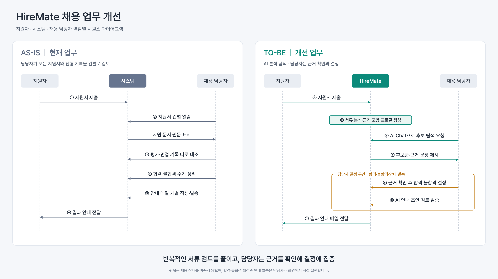
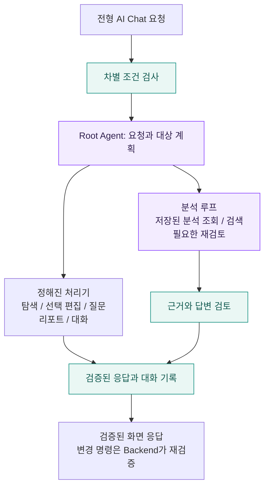
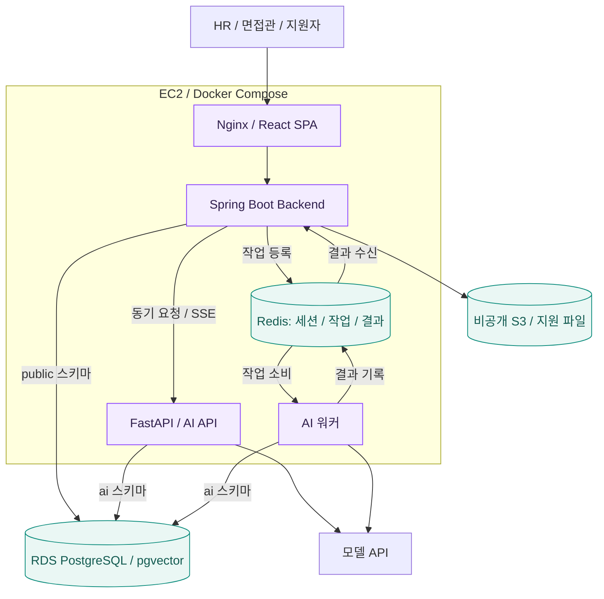

<div align="center">


# HireMate

### 채용의 반복 업무는 AI와 함께, 최종 결정은 담당자가.

공고 작성부터 지원자 분석, 면접 운영, 최종 리포트까지 연결하는<br />
**멀티에이전트 기반 E2E 채용 플랫폼**

<p>
  
  
  
  
</p>

[서비스 소개](#서비스-소개) / [주요 기능](#주요-기능) / [AI 설계](#멀티에이전트-설계) / [아키텍처](#시스템-아키텍처) / [시작하기](#시작하기)

</div>

---

## 서비스 소개

HireMate는 기업이 필요한 전형을 조합하고, 채용 담당자와 면접관이 같은 채용 흐름 안에서 일할 수 있도록 돕는 MVP다.
AI는 자료를 분석하고 후보를 탐색하며 초안을 작성한다. 담당자는 제시된 근거를 확인하고 채용 결정을 내린다.



> **반복적인 서류 검토를 줄이고, 담당자는 근거를 확인해 결정에 집중한다.**
> 합격과 불합격 결정, 전형 결과 확정, 공고 게시, 안내 발송은 담당자가 화면에서 직접 실행한다.

| 기존 업무의 어려움                                  | HireMate의 지원 방식                                      |
| --------------------------------------------------- | --------------------------------------------------------- |
| 지원 문서를 건별로 읽고 필요한 정보를 다시 정리한다 | 서류를 분석해 근거 문장이 포함된 지원자 프로필을 만든다   |
| 조건에 맞는 지원자를 찾기 위해 여러 자료를 오간다   | 전형별 AI Chat으로 후보를 탐색하고 근거와 출처를 확인한다 |
| 평가 결과와 면접 기록을 따로 대조한다               | 지원자별 전형 이력과 분석 결과를 함께 살펴본다            |
| 면접 질문과 안내 문구를 매번 작성한다               | 지원자별 질문과 안내 초안을 생성해 담당자가 검토한다      |

## 채용 흐름

**공고 작성 → 지원 접수 → 기업별 전형 운영 → 결과 확정과 안내 → 최종 리포트**

서류, 평가, 면접 등 필요한 전형을 조합한다. 다음은 서류와 면접을 포함한 운영 예시다.

| 단계        | 담당자가 하는 일                            | AI가 돕는 일                                          |
| ----------- | ------------------------------------------- | ----------------------------------------------------- |
| 공고 준비   | 채용 정보와 전형을 구성하고 공고를 게시한다 | 공고 본문과 포스터 디자인의 초안 및 수정안을 제안한다 |
| 지원 접수   | 제출 자료와 접수 현황을 확인한다            | 제출 문서를 분석하고 지원자 프로필을 갱신한다         |
| 전형 운영   | 기준과 근거를 확인해 지원자를 검토한다      | 후보 탐색, 평가 결과 분석, 확인할 점 정리를 돕는다    |
| 면접 진행   | 면접관을 배정하고 질문과 답변을 기록한다    | 맞춤 질문, 꼬리질문, 답변 분석을 제공한다             |
| 결과와 안내 | 전형 결과를 확정하고 안내를 발송한다        | 안내 문구와 최종 리포트의 초안을 작성한다             |

## 주요 기능

### 01. 공고 작성과 포스터 편집

AI와 대화하며 공고 초안을 작성하고 문구를 수정한다. 포스터 디자인을 제안받고 미리보기에서 검토한 뒤 적용한다.
웹 미리보기와 PDF는 같은 렌더러를 사용하며, Canva와 Templated 연동은 선택해서 설정할 수 있다.

### 02. 근거를 확인하는 지원자 분석

지원 문서, 평가 결과, 면접 답변을 분석해 지원자 정보를 정리한다.
분석 항목에는 근거 문장과 출처를 연결하고, 확인되지 않은 내용은 확인 필요로 남긴다.

### 03. 전형의 맥락을 아는 AI Chat

현재 채용과 전형의 지원자를 대상으로 질문하고 후보를 탐색한다.
선택 지원자 영역 편집과 면접 질문 생성을 요청할 수 있으며, 실제 변경은 Backend가 대상과 권한을 검증해 실행한다.
HR의 Chat 탭은 같은 기업 담당자가 공유하고, 면접관의 탭은 본인만 본다.

### 04. 담당 역할에 맞춘 면접 운영

인사와 실무 면접관을 배정하고 담당 질문, 답변, 꼬리질문과 개인 메모를 관리한다.
면접관은 배정된 지원자의 자료를 확인하고 자기 담당 질문에 답변을 기록한다.
자동 저장과 초안 복구로 기록을 이어가며, 저장 충돌이 생기면 최신 내용과 비교한다.

### 05. 안내 초안과 최종 리포트

담당자가 확정한 결과에 맞춰 안내 초안을 검토하고 발송한다.
전형별 분석과 지원자 비교 자료를 활용한 최종 리포트 초안으로 채용 과정을 돌아본다.

## 멀티에이전트 설계

Root Agent는 요청 종류와 지원자 범위를 계획하고 필요한 처리 경로를 고른다.
미리 정해진 작업은 처리기로 실행하고, 자료를 읽어야 다음 단계를 알 수 있는 요청은 분석 루프가 맡는다.
공고 작성과 포스터 대화는 공고 Agent가 직접 처리한다.



| Agent          | 책임                                                              |
| -------------- | ----------------------------------------------------------------- |
| Root           | 요청 계획, 대상 범위 해석, 탐색과 분석 조합, 근거 검토, 대화 기억 |
| 서류 분석      | 제출 문서 분석과 근거 확인, 지원자 프로필 갱신                    |
| 평가 분석      | 평가 결과와 제출물 분석                                           |
| 면접 분석      | 면접 답변 분석과 확인할 점 정리                                   |
| 공고 생성      | 공고 초안과 수정안, 포스터 디자인 제안                            |
| 면접 질문 생성 | 지원자 자료와 확인할 점에 맞춘 질문 생성                          |
| 안내 생성      | 담당자가 검토할 안내 초안 작성                                    |
| 리포트 생성    | 전형 결과와 지원자 비교를 활용한 리포트 초안 작성                 |

분석과 생성 Agent는 Python 함수로 기능을 공개한다. AI 서버 안에서 Agent끼리 HTTP로 호출하지 않는다.
자료가 들어올 때 워커가 미리 분석하고, Root는 저장된 분석을 읽어 조합한다.
분석이 없거나 재검토가 필요한 경우에만 하위 Agent를 다시 호출한다.

## 신뢰할 수 있는 AI 설계

| 원칙                              | 구현 방식                                                                          |
| --------------------------------- | ---------------------------------------------------------------------------------- |
| **담당자가 결정한다**             | AI에 합격과 불합격 결정, 결과 확정, 게시, 발송 도구를 제공하지 않는다              |
| **근거를 확인한다**               | 분석 근거가 원문에 있는지 확인하고, Root는 근거 번호를 인용해 출처를 연결한다      |
| **과장된 답을 낮추거나 제외한다** | 주장과 근거를 검토하고 확인이 부족한 항목은 확인 필요로 표시한다                   |
| **조회 범위를 제한한다**          | 현재 기업, 채용, 전형을 코드가 지정하고 면접관은 배정된 지원자만 조회한다          |
| **제출 자료와 지시를 구분한다**   | 문서와 URL 본문은 신뢰하지 않는 자료 블록으로 감싸며 도구 권한을 바꾸지 못한다     |
| **차별 조건을 차단한다**          | 나이, 성별, 출신 지역, 혼인 여부, 신체 조건을 이용한 탐색과 필터링 요청을 차단한다 |
| **검증 후 스트리밍한다**          | 화면에는 정해진 단계 문구와 검증을 마친 항목만 먼저 보낸다                         |

NCS는 담당자의 판단을 돕는 참고자료로 사용한다. 참고한 경우 검증된 출처를 별도로 보여주며,
NCS의 직무 설명을 지원자가 실제로 수행한 사실처럼 취급하지 않는다.

## 시스템 아키텍처

운영 환경에서 외부 요청은 Nginx로 들어온다. Backend는 업무 데이터와 권한, 상태 변경을 담당하고,
AI API는 화면에서 기다리는 요청을 처리한다. 시간이 걸리는 분석과 리포트 작업은 Redis 대기열로 워커에 맡긴다.



- **업무 데이터의 쓰기 주체는 Backend**다. AI는 지원자 프로필, 분석 결과, 호출 로그와 Chat 대화를 `ai` 스키마에 저장한다.
- **비동기 작업은 Redis Streams**로 전달한다. 워커는 결과 스트림에 응답하고 Backend가 결과를 반영한다.
- **지원 파일은 비공개 S3**에 보관하고 서명 URL로 접근한다. 로컬 개발에서는 로컬 파일 저장소를 사용한다.
- **DB 마이그레이션은 스키마별로 분리**한다. Backend의 `public` 스키마는 Flyway, AI의 `ai` 스키마는 Alembic으로 관리한다.

## 기술 스택과 저장소

| 영역                 | 주요 기술                                                      | 선택한 역할                                 |
| -------------------- | -------------------------------------------------------------- | ------------------------------------------- |
| Frontend             | React 19, TypeScript, Vite, Tailwind CSS, shadcn/ui            | HR 콘솔, 면접관 모드, 지원자 채용 페이지    |
| 클라이언트 상태와 폼 | TanStack Query, Zustand, React Hook Form, Zod                  | 서버 상태, 클라이언트 상태, 입력 검증       |
| Backend              | Java 25, Spring Boot 4, Spring Security, Spring Modulith, JPA  | 업무 API, 인증과 권한, 모듈 경계            |
| AI                   | Python 3.13, FastAPI, LangGraph, LangChain                     | 요청 계획, 분석과 생성, SSE 응답            |
| 데이터               | PostgreSQL 17, pgvector, Redis 8, S3                           | 업무 데이터, 벡터 검색, 세션과 대기열, 파일 |
| 인프라               | Docker Compose, Nginx, GitHub Actions, AWS EC2 / RDS           | 실행 환경과 CI/CD                           |
| 품질                 | Checkstyle, Vitest, ESLint, Ruff, mypy, pytest, Testcontainers | 코드 검사와 자동 테스트                     |

```text
HireMate/
├── frontend/              HR 콘솔, 면접관 모드, 지원자 페이지
│   └── src/
│       ├── app/           라우트와 공통 레이아웃
│       ├── pages/         사용자별 화면
│       ├── features/      업무 기능별 컴포넌트와 훅
│       └── lib/api/       API 클라이언트와 생성된 계약 타입
├── backend/               업무 서버와 권한 검증
│   └── src/main/
│       ├── java/com/hiremate/  업무별 모듈
│       └── resources/db/  Flyway 마이그레이션
├── ai/
│   └── src/hiremate_ai/
│       ├── agents/        Root, 분석, 생성 Agent
│       ├── llm/           공통 모델 클라이언트와 호출 기록
│       ├── db/            AI 스키마와 Alembic 마이그레이션
│       ├── ncs_search/    NCS 참고 검색과 질의 임베딩
│       └── worker/        비동기 작업 처리
├── contract/              Backend와 AI가 공유하는 JSON 계약 샘플
├── scripts/demo/          가상 지원자를 이용한 데모
├── compose.yaml           로컬 PostgreSQL, Redis, Mailpit
└── compose.production.yaml  운영 서비스 구성
```

## 시작하기

### 1. 개발 도구 준비

| 도구    | 기준                                                                   |
| ------- | ---------------------------------------------------------------------- |
| Docker  | 로컬 PostgreSQL, Redis, Mailpit과 Testcontainers 실행                  |
| Node.js | 24                                                                     |
| Java    | 25. 설치되어 있지 않으면 Gradle이 내려받는다                           |
| Python  | 3.13 이상. 개발 버전은 [`ai/.python-version`](ai/.python-version) 참고 |
| uv      | AI 의존성 설치와 Python 명령 실행                                      |

저장소 루트에서 한 번 실행해 커밋 메시지 검사와 `main` 직접 push 차단 훅을 켠다.

```bash
git config core.hooksPath .githooks
```

### 2. Backend와 Frontend 실행

각 명령 묶음은 **저장소 루트에서 시작하는 별도 터미널**에서 실행한다.
기본 AI 연동은 고정된 개발용 응답을 반환하는 `stub` 모드이므로, 모델을 연결하지 않고도 화면을 살펴볼 수 있다.

**Backend**

```bash
cd backend
./gradlew bootRun
```

Backend를 실행하면 루트의 `compose.yaml`로 로컬 인프라가 자동으로 시작된다.

**Frontend**

```bash
cd frontend
npm ci
npm run dev
```

| 주소                                    | 용도                                |
| --------------------------------------- | ----------------------------------- |
| `http://localhost:5173`                 | 웹 앱. `/api` 요청은 Backend로 전달 |
| `http://localhost:8080`                 | Backend API                         |
| `http://localhost:8080/swagger-ui.html` | API 문서. HR 로그인 필요            |
| `http://localhost:8025`                 | Mailpit. 로컬에서 발송한 메일 확인  |

웹 앱의 `/signup`에서 기업과 HR 계정을 만든 뒤 `/login`에서 로그인한다.
면접관 계정은 HR이 기업 설정에서 생성한다. 지원자는 `/careers/:postingId`에서 공고를 확인하고 지원한다.

### 3. 실제 AI 연결

화면과 업무 API만 개발할 때는 생략할 수 있다. 실제 모델을 사용하려면 로컬 인프라와 AI API를 실행한다.

```bash
# 저장소 루트에서 실행
# AI만 개발할 때도 먼저 로컬 인프라를 시작한다
docker compose up -d

# 기존 ai/.env가 없을 때 예시를 복사하고 모델 연결 값을 채운다
cd ai
cp -n .env.example .env
uv sync --locked
uv run alembic upgrade head
uv run uvicorn hiremate_ai.main:app --reload --port 8001
```

[`ai/.env.example`](ai/.env.example)을 참고해 `LLM_BASE_URL`, `LLM_MODEL`, `LLM_API_KEY`와
필요한 출력 형식을 설정한다. 실제 키는 `.env`에만 보관한다.

Backend는 시작할 때 연동 모드를 읽는다. 실행 중이면 종료한 뒤, 사용할 Agent에 맞춰 다시 실행한다.
다음 예시는 공고와 포스터 기능만 실제 AI로 연결한다.

```bash
cd backend
HIREMATE_AI_AGENTS_POSTING=remote ./gradlew bootRun
```

| 환경 변수                              | 용도                                                         |
| -------------------------------------- | ------------------------------------------------------------ |
| `HIREMATE_AI_MODE`                     | 전체 Agent 기본 모드. 기본값 `stub`, 실제 AI 연결은 `remote` |
| `HIREMATE_AI_AGENTS_ROOT`              | 전형 AI Chat의 Root Agent 모드                               |
| `HIREMATE_AI_AGENTS_POSTING`           | 공고와 포스터 Agent 모드                                     |
| `HIREMATE_AI_AGENTS_APPLICATION`       | 지원서 분석 Agent 모드                                       |
| `HIREMATE_AI_AGENTS_INTERVIEW_ANALYST` | 면접 답변 분석 Agent 모드                                    |
| `HIREMATE_AI_BASE_URL`                 | AI API 주소. 기본값 `http://localhost:8001`                  |

다른 Agent도 `hiremate.ai.agents.{key}` 설정으로 개별 전환할 수 있다.
키 목록은 [`application.yml`](backend/src/main/resources/application.yml)의 `hiremate.ai` 설정을 참고한다.

**AI 워커**는 별도 터미널에서 실행한다. 지원서, 평가 결과, 면접 답변 분석과 면접 질문 자동 생성,
최종 리포트 등 대기열을 사용하는 Agent를 `remote`로 설정할 때 필요하다.

```bash
cd ai
uv run python -m hiremate_ai.worker
```

Windows에서 `--reload` 없이 AI API를 실행하다 psycopg 이벤트 루프 오류가 나면
`--loop asyncio:SelectorEventLoop`를 지정한다.

### 4. 가상 지원자로 데모 확인

[`서류 전형 데모 가이드`](scripts/demo/README.md)에 가상 지원자 30명과 샘플 공고를 넣는 절차가 있다.
실제 모델 분석을 확인하려면 AI API와 워커를 실행하고 해당 Agent를 `remote`로 설정한다.

로컬 기본 설정에는 평가 결과와 서류 평가 기준의 데모 데이터가 포함된다.
외부 평가 업체 연동 결과로 해석하지 않으며, 데모 밖에서는 설정을 확인한다.
운영 Compose는 `HIREMATE_DUMMY_ASSESSMENT=false`로 평가 결과 더미를 끈다.

## 검사와 기여

변경한 영역의 검사를 실행한다. DB나 Redis를 사용하는 테스트는 Docker가 필요하다.
아래 명령도 저장소 루트에서 각각 실행한다.

| 영역     | 검사 명령                                                                                  |
| -------- | ------------------------------------------------------------------------------------------ |
| Backend  | `cd backend && ./gradlew check`                                                            |
| Frontend | `cd frontend && npm run check`                                                             |
| AI       | `cd ai && uv run ruff check && uv run ruff format --check && uv run mypy && uv run pytest` |

Frontend의 API 타입은 Backend의 OpenAPI 문서에서 생성한다.
Backend를 실행하고 `cd frontend && npm run api:generate`를 사용하며, 생성된 `schema.d.ts`는 직접 수정하지 않는다.

`main`에 직접 커밋하거나 push하지 않는다. 작업 브랜치에서 변경하고 검사를 통과한 뒤 PR로 올린다.
브랜치, 커밋과 PR의 세부 규칙은 [기여 가이드](CONTRIBUTING.md)를 따른다.

## 개발과 운영 문서

| 문서                                           | 내용                                       |
| ---------------------------------------------- | ------------------------------------------ |
| [기여 가이드](CONTRIBUTING.md)                 | 브랜치, 커밋과 PR, CI, 영역별 검사         |
| [AI 코딩 에이전트 규칙](AGENTS.md)             | 업무 경계, 권한, 패키지와 Agent 구현 규칙  |
| [Backend와 AI 계약](contract/README.md)        | 공통 JSON 샘플과 양쪽 계약 검사            |
| [가상 지원자 데모](scripts/demo/README.md)     | 샘플 공고와 지원자 30명으로 서류 전형 확인 |
| [AI 테스트 샘플](ai/tests/samples/README.md)   | 가상 지원자별 검증 기준                    |
| [리포트 평가](ai/tests/eval/report/README.md)  | 리포트 Agent의 실제 모델 평가              |
| [Backend 환경 변수 예시](backend/.env.example) | Canva와 Templated 연동                     |
| [AI 환경 변수 예시](ai/.env.example)           | 모델, 워커, 추적과 NCS 설정                |
| [운영 환경 변수 예시](.env.example)            | AWS 운영 설정                              |

아래는 연동이나 운영 시 필요한 상세 안내다.

<details>
<summary><strong>공고와 포스터: AI 생성, 무료 SVG와 편집 복구</strong></summary>

포스터 디자인과 대화 처리는 공고 Agent의 `generation/posting` 모듈에 있다.

배너 이미지는 외부 이미지 API 대신 로컬 Z-Image-Turbo로 생성한다. `POSTER_API_KEY`와
`POSTER_LLM_MODEL=gpt-6-luna`는 선택적으로 텍스트 디자인 설계와 채팅 수정에만 사용한다.
전체 모델은 `LLM_PROFILE=local`이면 `LOCAL_LLM_*`, `LLM_PROFILE=openai`이면
`OPENAI_BASE_URL`, `OPENAI_MODEL`, `OPENAI_API_KEY`를 사용한다. 두 설정을 함께 보관하고
프로필 한 줄로 전환할 수 있다. 기존 `LLM_*` 직접 설정은 `LLM_PROFILE=custom`으로 유지한다.
`POSTER_LLM_MODEL`을 비우면 기본 `LLM_MODEL`(로컬 Gemma 등)이 참고 이미지 분석·설계·수정을 모두 맡는다.
단일 GPU에서 `POSTER_LOCAL_RELEASE_OLLAMA=true`로 두면 Gemma 설계 이후 Ollama 가중치만 내리고
Z-Image를 실행한다. Ollama 서버는 유지되며 다음 대화에서 Gemma가 다시 적재된다.
AI 배너 이미지를 생성하려면 로컬 이미지 모델과 GPU 실행 환경이 필요하다. `POSTER_LOCAL_MODEL_PATH`에
다운로드한 모델 폴더, `POSTER_LOCAL_PYTHON`에 GPU 전용 Python 실행 파일을 지정한다. 둘 중 하나라도
비어 있으면 AI 서버 로그에 배너 생성 생략을 남기고, 설정된 언어 모델로 배너 이미지 없이 포스터를 생성한다.
별도 이미지 서버나 포트를 열지 않고 AI 서버가 자식 프로세스를 순차 실행하며,
동일한 요청은 `POSTER_LOCAL_IMAGE_CACHE`의 JPEG를 재사용한다. 실패 시 유료 이미지 API로 전환하지 않는다.

로컬 GPU 환경은 업무 서버의 CPU 패키지와 분리한다. CUDA 12.8용 PyTorch 2.7.1, Diffusers 0.36.0,
Transformers 4.57.1, Accelerate 1.12.0, bitsandbytes 0.48.2, Pillow 12.0.0, SentencePiece 0.2.1을 사용한다.
추가 이유는 이미지 추론과 16GB GPU용 8-bit 가중치 적재이며, 기본 서버 의존성에는 포함하지 않는다.
Docker 안에서 별도 가상환경에 설치하고 기존 관리 스크립트의 AI 서버에만 GPU를 연결한다.
키는 기존 `POSTER_IMAGE_API_KEY` 이름도 읽지만 이미지 생성에는 사용하지 않는다.

`ai/.env`의 `POSTER_REFERENCES_PATH`에 참고 색인 JSON 경로를 지정하면 생성 모델이 회사·직무·공고 분량에
맞는 디자인 메모를 후보별로 선택한다. 후보별 첫 참고 ID를 다르게 검증하며, 선택한 ID와 메모·출처를
생성 캔버스의 `designReferences`에 보존한다. 색인은 `references` 목록에 `id`, `role`, `title`,
`designAdaptation`, `postingUrl`을 갖는다. `POSTER_REFERENCE_IMAGES_PATH`에 미리 준비한 JPEG 폴더를
지정하면 이미지가 있는 사례 중 모델이 3개를 고르고, 각 사례의 전체 이미지와 상단 확대 이미지를
생성 모델에 직접 전달한다. 파일명은 `{id}.jpg`, 선택적 상단 이미지는 `{id}-header.jpg`다.
이미지 바이트는 호출 로그나 공고에 저장하지 않으며, 캔버스에는 `referenceMode=IMAGE`와 선택한 출처만 남긴다.
이미지 폴더를 설정했는데 준비된 사례가 부족하면 메모 기반 결과를 이미지 분석 결과로 표시하지 않고 안내한다.
로컬 테스트 색인 `ai/.local/poster-references.json`은 Git에서 제외하며, 설정이 없으면 기본 생성으로 진행한다.

포스터 챗의 “템플릿 만들어줘”는 검색과 별개의 생성 도구를 사용한다. 연결된 모델이 새 배치·서체 크기·배색·항목 순서를
설계해 서로 다른 디자인 3개를 제안한다. 생성안을 본 뒤 “다른 걸로 또 만들어줘”는 연결된 외부 제공처에서
다른 후보를 찾는다. “자체 생성으로 다시 만들어줘”를 명시하면 최근과 같은 구성을 제외하고 다시 생성한다.
고급스럽게·색상·아이콘 등 부분 수정은 현재 템플릿을 유지한다. Canva/Templated에서 생성했다고 표시하지 않는다.
외부 검색은 Templated와 `ORSHOT_TEMPLATE_IDS`로 승인한 Orshot 공용 원본, 연결한 Canva 계정의 디자인을
함께 조회한다. Orshot 계정 전체의 개인 디자인은 검색하지 않는다. 적용한 회사 템플릿과 현재 선택 원본은
식별자로 제외하며 같은 원본을 다른 이름으로 다시 저장하지 않는다. Orshot 검색에는 렌더링 크레딧을 쓰지 않고,
선택 시 글을 지운 정지 배경을 렌더링하고, 영상 원본이 있으면 MP4도 렌더링한다. 같은 서버 실행 중에는
원본별 결과를 재사용한다. 채용 본문은 외부로 보내지 않고 HireMate에서 측정해 편집 가능한 본문으로 확장한다.
웹은 원본 배경 영상을 반복 재생하고 글자는 고정한다. 일시정지·움직임 축소를 지원하고 PDF는 정지 SVG만 출력한다.
미리보기에서 수정안을 적용하면 회사 템플릿에 추가한다. 채용 문구는 생성 데이터에 복사하지 않고 현재 공고에서 채운다.
본문 높이는 화면과 PDF가 사용하는 공통 렌더러에서 실측하고, 전형 절차, 제출 서류는 전체 폭으로 이어 배치한다.
생성안은 본문 배치와 전형, 서류 표현도 달리하며, 전체 대표색 변경은 본문과 강조색에도 적용한다.
생성 모델은 6개 편집 체계와 3개 표현 방식 중 현재 요청과 이전 제안에 맞는 조합을 고른다.
검증된 타이포, 여백, 배색 비례로 조합하며 최근과 같은 편집 체계, 표현 조합은 제외한다.
포스터의 Noto Sans KR은 Fontsource 패키지로 직접 제공한다. 외부 글꼴 서버에 의존하지 않고,
측정 전에 한글 글꼴을 로드한 후 문서 내 SVG로 출력해 미리보기와 인쇄의 글자 폭을 일치시킨다.
`@fontsource-variable/noto-sans-kr` 추가 이유는 예시 포스터와 같은 글꼴을 화면, PDF에서 안정적으로 쓰기 위해서다.
회사 소개와 직무를 바탕으로 상단 한 줄 문구를 제안하며 별도 입력 항목은 추가하지 않는다.
채팅 수정안은 가운데 포스터에 먼저 표시하고 바뀐 영역에 공통 보라색 테두리와 `AI 수정` 표시를 붙인다.
적용 전에는 실제 디자인을 바꾸지 않으며 되돌리면 미리보기를 해제한다. 표시 테두리는 PDF에 포함하지 않는다.
“상단 물결을 움직이게”, “은은한 빛이 흐르게”, “움직임 꺼줘”는 공고 Agent의 움직임 도구가
현재 템플릿·배색·문구·아이콘을 보존하고 상단 장식만 제안한다. 내장·생성·가져온 디자인 모두 지원하며,
원본 GIF/영상의 재생이나 다운로드와는 별개다. 웹에서는 재생/일시정지가 가능하고 기기의 움직임 줄이기
설정을 따른다. PDF용 복제본은 동일한 장식을 정지 구도로 출력하며 재생 버튼은 포함하지 않는다.
작성 중인 공고 카드는 마지막으로 방문한 글 작성, 포스터, 게시 설정 단계로 이어진다.
편집 위치만 기업, 계정, 공고별로 현재 브라우저에 기억하며, 게시된 공고와 전형 진행 경로는 기존 상태를 따른다.
`/agents/posting/design`은 해당 모듈을 직접 호출하며 전형 Root를 거치지 않는다.

포스터 챗의 “외부 무료 SVG 템플릿 찾아줘”는 검증한 무료 제공처의 양식을 실제로 내려받아 후보로 보여 준다.
현재 제공처는 [inkscape.de의 CC0 기본 양식 3종](https://inkscape.de/vorlagen/)이며,
인터넷 전체 검색이나 금융권 전용 디자인 라이브러리는 아니다. API 키, 유료 구독은 사용하지 않는다.
카드의 “공고에 적용” 또는 “첫 번째 무료 템플릿으로 적용해줘”로 가져온 뒤,
“제목을 크게”, “복지를 오른쪽으로”, “본문을 세리프 글꼴로”처럼 요소별 배치를 수정할 수 있다.
실제 문구는 매번 현재 공고에서 읽으며, 원본 양식의 문구는 사용하지 않는다.
원본 SVG의 실행 요소와 외부 참조는 제거하고, 편집 데이터와 출처는 기존 포스터 디자인 JSON에 저장한다.
기본 템플릿 카드를 선택하면 기존 포스터로 돌아간다. 웹 미리보기와 PDF는 같은 벡터 출력을 사용한다.
무료 편집 엔진으로 MIT 라이선스의 Fabric.js를 추가했다. 위치, 서체, 크기를 개별 요소로 관리하고
SVG를 가져와 다시 벡터로 출력하기 위해 필요하며, 별도 편집 서비스 구독은 없다.

포스터의 이전 추천은 현재 공고의 최근 12개 대화 턴과 디자인 식별자로 참조한다.
본문, 전형, 포스터의 미저장 편집과 포스터 대화는 같은 탭의 `sessionStorage`에 임시 보관한다.
포스터 화면에서는 수정한 채 다른 앱 페이지로 이동하면 먼저 업무 API로 임시 저장하고 공통 성공 알림을 표시한다.
저장에 실패하면 이동하지 않고 편집 내용과 복구본을 유지한다. 수동 임시 저장도 같은 공통 알림을 사용한다.
선택한 추가 템플릿을 삭제하면 설정에 저장된 기업 기본 템플릿과 배색으로 돌아간다.
새로고침과 화면 이동 후 같은 공고를 열면 복구하며, 서버 내용이 바뀌었거나 게시한 공고에는 복구본을 적용하지 않는다.
탭을 닫거나 다른 기기에서 이어 쓰려면 먼저 화면의 임시 저장을 눌러야 한다.

실제 모델의 공고 회귀 평가는 AI 폴더에서 `LLM_EVAL=true uv run pytest tests/eval/test_posting_eval.py -v`로 실행한다.
설정된 모델을 실제 호출하며, 근무지 표현 변형, 경력 조건 일치, 초안 분량, 추천 복원, 기록 없는 요청을 검사한다.

</details>

<details>
<summary><strong>외부 포스터 테마: Templated</strong></summary>

- `backend/.env`에 `TEMPLATED_API_KEY`를 설정한다. 키와 실제 공고는 외부 모델이나 프런트엔드에 보내지 않는다.
- 일반적인 외부 템플릿 검색은 공고 Agent의 `find_external_templates`가 영어 검색 조건을 정하고
  backend가 공개 갤러리에서 최대 3개의 서로 다른 후보를 조회한다. 사진, 동영상이나 영수증, 이력서 등
  채용 공고로 변환하기 부적합한 양식은 제외하므로 결과가 3개 미만일 수 있다.
- `TEMPLATED_TEMPLATE_IDS`에는 관리자가 공용으로 사용하기로 한 가상 샘플 ID만 쉼표로 등록한다.
  개인 계정 전체 디자인은 조회하지 않으며 실제 기업의 비공개 공고를 이 목록에 넣지 않는다.
- 결과는 원본 테마의 안전한 벡터, 텍스트 미리보기다. 적용 시 예시 문구를 제거하고 배경, 배색을 보존하며
  현재 공고를 웹 폰트로 다시 배치한다. 원본 픽셀 배치를 그대로 복제하는 방식은 아니다.
  본문은 실제 글자 높이로 늘리고 전형 절차, 제출 서류는 전체 너비로 표시한다.
- 테마 적용은 `외부템플릿1`부터 새 카드로 저장한다. 선택한 카드를 삭제하면 기업 설정에 저장한 기본
  템플릿, 색상으로 돌아간다. 임시 저장 버튼과 다른 화면으로 이동할 때 서버에 초안을 저장하며,
  기존 공통 알림으로 결과를 알린다. 저장 실패 시 화면 이동을 멈추고 초안을 유지한다.
- 검색, 가져오기에는 GET API만 사용한다. 렌더, 결제, AI 생성 API는 앱에서 호출하지 않으며,
  미리보기와 PDF는 HireMate에서 처리한다. 외부 계정의 요금, 라이선스는 서비스 약관을 따른다.
- 공식 API: https://templated.io/docs/templates/gallery/

</details>

<details>
<summary><strong>로컬 Canva OAuth 연결</strong></summary>

- `backend/.env.example`을 `backend/.env`로 복사하고 Canva 개발자 앱의 Client ID와 Secret을 넣는다.
  `.env`는 Git에서 제외된다. Secret은 프런트엔드나 AI 프롬프트에 전달하지 않는다.
- Canva 개발자 페이지의 Outside Canva에서 Canva MCP를 켜고 Redirect URLs에
  `http://127.0.0.1:5173/api/companies/me/canva/callback`을 등록한다.
- 표준 로컬 환경을 다시 켠 뒤 설정 → 채용 공고 → Canva 연결에서 본인의 계정을 승인한다.
  OAuth는 PKCE와 일회성 state를 사용하며 승인한 HR의 기업, 사용자, 로그인 세션에 묶인다.
- 서버가 실제 MCP 초기화와 tools/list를 확인한 뒤에만 연결됨으로 표시한다.
  무료 여부를 도구 존재만으로 단정하지 않는다. OAuth 연결은 현재 로그인 세션에 유지되며
  로그아웃, 세션 만료 후에는 다시 연결해야 한다. 연결 해제는 HireMate 세션의 토큰을 지운다.
- 포스터 챗에서 “Canva에서 금융권 채용 포스터 찾아줘”라고 요청하면 연결한 계정의 소유, 공유 디자인을 검색한다.
  검색 결과는 같은 ID, 제목의 복사본을 묶은 최대 3개이며, 추가한 카드 이름은 `외부템플릿1`부터 빈 순번으로 지정한다.
  Canva 전체 공개 템플릿 검색이나 유료 구독 신청은 수행하지 않는다. Codex의 Canva 플러그인 연결과는 독립적이다.
- 결과 카드에서 가져오기를 누르면 첫 페이지의 작업 복사본을 만들고 현재 계정의 일반 PNG 내보내기 가능 여부를 확인한다.
  원본 글자를 지운 임시 편집본에서 배경과 글 영역을 읽은 뒤 임시 편집을 취소한다. 원본은 덮어쓰지 않는다.
  현재 공고 내용은 로컬에서 연결하고 새 이름의 회사 템플릿으로 저장한다. Canva에 공고 내용은 보내지 않는다.
- 가져온 글자의 크기, 정렬, 너비, 배치는 챗으로 수정한다. 배경 장식은 이미지로 보존하므로 Canva 원본에서 수정 후 다시 가져온다.
  LLM이 원본 영역과 공고 항목을 연결하고, 렌더러는 실제 글자 높이로 행 간격과 포스터 길이를 늘린다.
  상단 배경 이미지를 보존하고 본문은 원본의 열 구성, 종이색, 강조선에 맞춰 재구성한다. 원본의 채용 사실은 복사하지 않는다.
  전형 절차와 제출 서류는 각각 전체 너비의 행으로 표시한다. 기존에 가져온 양식도 편집 화면에서 새 구성으로 변환한다.
  로고는 원본 윤곽을 지우지 않고 밝은 대표색 받침을 사용한다. 원본의 빈 로고 자리 장식은 추출에서 제외한다.
  유료 요소, 계정 이용 한도 때문에 내보내기가 거절되면 가져오기를 중단한다. 무료 이용량을 보장하지 않는다.

</details>

<details>
<summary><strong>인증 API와 CSRF</strong></summary>

같은 출처 SPA에서 이메일과 비밀번호로 로그인하며 인증 세션은 Redis에 보관한다.
로컬 기본 만료 시간은 마지막 요청 기준 1일이며, 운영 Compose에서는 30분으로 설정한다.
쿠키는 HttpOnly와 SameSite=Lax이며 HTTPS 요청에서는 Secure를 적용한다. 운영 Nginx는 외부에서 온
forwarded 헤더를 덮어써야 한다. Spring Session Redis starter는 서버 인스턴스 사이에서 인증 세션을 공유하기 위해 추가했다.

| 메서드 | 경로               | 응답 및 조건                                                  |
| ------ | ------------------ | ------------------------------------------------------------- |
| GET    | `/api/auth/csrf`   | 공개. `token`, `headerName`, `parameterName`                  |
| POST   | `/api/auth/signup` | CSRF 필수. 새 기업과 HR 생성, 201. 자동 로그인하지 않음       |
| POST   | `/api/auth/login`  | CSRF 필수. 로그인, 200. 세션 ID 및 CSRF 교체                  |
| POST   | `/api/auth/logout` | CSRF 필수. 세션 및 쿠키 제거, 204                             |
| GET    | `/api/auth/me`     | 로그인 필수. `memberId`, `companyId`, `name`, `email`, `role` |

가입은 `companyName`, `name`, `email`, `password`만 사용한다. 기업과 역할을 선택할 수 없으며 신규 기업 HR로
생성한다. 이름은 공백이 아닌 최대 100자, 이메일은 유효한 최대 254자다. 이메일의 앞뒤 공백은 제거하고 소문자로
저장한다. 비밀번호는 공백이 아닌 12~128자이며 앞뒤 공백을 보존한다. PBKDF2-HMAC-SHA256, 16바이트 salt,
600000회 해시를 사용하며 비밀번호 및 해시는 응답과 세션 principal에 포함하지 않는다.

클라이언트는 시작할 때 CSRF를 조회하고 응답의 `headerName` 헤더에 `token`을 보낸다. 로그인과 로그아웃에
성공하면 CSRF를 다시 조회해야 한다. 아래 예제는 curl과 jq를 사용하며 테스트용 비밀번호를 환경 변수로 받는다.

```bash
BASE_URL=http://localhost:8080
COOKIE_JAR=$(mktemp)
read -rs HIREMATE_TEST_PASSWORD

CSRF=$(curl -sS -c "$COOKIE_JAR" -b "$COOKIE_JAR" "$BASE_URL/api/auth/csrf" | jq -r '.token')
jq -n --arg password "$HIREMATE_TEST_PASSWORD" \
  '{companyName:"테스트 기업",name:"테스트 HR",email:"hr@example.com",password:$password}' \
  | curl -sS -c "$COOKIE_JAR" -b "$COOKIE_JAR" -H 'Content-Type: application/json' \
      -H "X-CSRF-TOKEN: $CSRF" --data-binary @- "$BASE_URL/api/auth/signup"

jq -n --arg password "$HIREMATE_TEST_PASSWORD" '{email:"hr@example.com",password:$password}' \
  | curl -sS -c "$COOKIE_JAR" -b "$COOKIE_JAR" -H 'Content-Type: application/json' \
      -H "X-CSRF-TOKEN: $CSRF" --data-binary @- "$BASE_URL/api/auth/login"
CSRF=$(curl -sS -c "$COOKIE_JAR" -b "$COOKIE_JAR" "$BASE_URL/api/auth/csrf" | jq -r '.token')
curl -sS -b "$COOKIE_JAR" "$BASE_URL/api/auth/me"
curl -i -c "$COOKIE_JAR" -b "$COOKIE_JAR" -H "X-CSRF-TOKEN: $CSRF" -X POST "$BASE_URL/api/auth/logout"
CSRF=$(curl -sS -c "$COOKIE_JAR" -b "$COOKIE_JAR" "$BASE_URL/api/auth/csrf" | jq -r '.token')
rm "$COOKIE_JAR"
unset HIREMATE_TEST_PASSWORD
```

실패는 `application/problem+json`으로 반환한다. 입력 오류는 400 `INVALID_INPUT`, 미인증은 401
`UNAUTHENTICATED`, 잘못된 자격 증명은 401 `INVALID_CREDENTIALS`, 권한 부족은 403 `FORBIDDEN`,
CSRF 오류는 403 `INVALID_CSRF`, 이메일 중복은 409 `EMAIL_ALREADY_EXISTS`다.

업무 진입 경로인 `/api/companies`, `/api/recruitments`, `/api/stages`와 하위 경로 및 Swagger/OpenAPI 조회는
HR로 제한한다. 배정된 자료 읽기와 개인 Chat 탭은 면접관 접근 정책으로 별도 검증한다.
업무 API는 인증된 `companyId`와 실제 데이터 소유 기업을 함께 검증한다. 지원자용 `/api/public/**`는
로그인 없이 사용하며, POST 요청에는 CSRF 토큰이 필요하다. 그 밖에 허용하지 않은 경로는 차단한다.

면접관 계정은 HR이 기업 설정에서 생성한다. 기존 기업 가입, 계정 정지 및 역할 변경,
이메일 확인, 비밀번호 재설정은 아직 구현하지 않았다.
같은 기업 HR는 동일한 권한을 가지며 채용별 배정 정책은 후속 결정이 필요하다.

</details>

<details>
<summary><strong>면접관 API와 면접 기록 복구</strong></summary>

계정 권한(HR/INTERVIEWER)과 면접 역할(HR/PRACTICAL)은 별개다. 면접 역할을 배정해도 계정 권한은
바뀌지 않는다. 같은 기업의 면접관 계정 두 개(인사, 실무)를 배정하고 HR 계정은 배정하지 않는다. 면접관 계정은
설정 › 면접관에서 HR이 만들고, `/api/interviewer/**`는 면접관 계정만 쓴다.

HR 관리 API:

- GET /api/companies/current/interview-members: 배정 가능한 현재 기업 계정 목록.
- GET /api/stages/{stageId}/candidates/{applicationId}/interview/session: 배정, 진행 상태.
- PUT 같은 주소: hrMemberId, practicalMemberId. 서로 다른 같은 기업의 계정만 허용한다.
  기존 배정을 바꿀 때는 조회한 expectedVersion도 보낸다. 시작 또는 답변 기록 후에는 배정을 바꿀 수 없다.

면접관 API의 기준 주소는 /api/interviewer/sessions다. 기업, 사용자는 로그인 세션에서 확인한다.

| 메서드 | 기준 주소 뒤 경로                                        | 내용                                                          |
| ------ | -------------------------------------------------------- | ------------------------------------------------------------- |
| GET    | 없음                                                     | 본인 배정 목록. page=0, size=30(최대 50)                      |
| GET    | /{stageId}/{applicationId}                               | myRole, personalMemo, personalMemoVersion, session, questions |
| POST   | /{stageId}/{applicationId}/start 또는 /end               | 예정 → 진행 중 → 종료                                         |
| PUT    | /{stageId}/questions/{questionId}/answer                 | answer, analyze, expectedVersion                              |
| POST   | /{stageId}/{applicationId}/questions                     | text, interviewerRole. 본인 역할만 지정                       |
| POST   | /{stageId}/questions/{questionId}/follow-ups             | text, source, check. 원래 담당 유지                           |
| POST   | /{stageId}/questions/{questionId}/follow-ups/suggestions | avoid 목록. 자기 담당만 AI 제안 요청                          |
| DELETE | /{stageId}/questions/{questionId}                        | 자기 담당의 미응답 질문만 삭제                                |
| PUT    | /{stageId}/{applicationId}/memo                          | text, expectedVersion(personalMemoVersion). 개인 메모         |

questions는 자기 담당이 먼저이며 각 항목에 question, canAnswer, canRequestFollowUp, canDelete,
readOnlyReason이 있다. personalMemo는 현재 면접관의 것만 반환한다. 기존 HR 공용 메모는 그대로다.
개인 메모 저장에는 personalMemoVersion을 expectedVersion으로 보낸다. session.version은 배정, 진행 상태의
버전이며 메모 저장에 사용하지 않는다. 인사, 실무가 서로의 개인 메모를 저장해도 충돌하지 않고, 같은 개인 메모의
오래된 버전으로 저장하면 409 MEMO_CONFLICT를 반환한다. 상대방의 개인 메모와 메모 버전은 응답에 포함하지 않는다.
면접 시작 전 모든 질문의 담당을 지정한다. 시작, 종료는 합격, 불합격 결정과 별개이며, 미입력으로 자동 종료하지
않는다. 종료할 때 자동 저장만 된 답변도 분석에 넘긴다.
진행 중인 면접이 하나라도 있으면 전형 결과 확정은 409 INTERVIEW_IN_PROGRESS로 거절한다.
면접 시작과 전형 확정, 최초 배정의 동시 요청은 전형 잠금으로 순서를 보장한다.

면접관 기록은 진행 중인 전형, 면접에서만 허용한다. 기존 HR 답변, 질문, 꼬리질문 API도 배정이 있으면
동일한 역할, 상태 검사를 적용한다. HR은 시작 전 담당을 조정할 수 있지만, 답변이 있는 질문의 기존 담당과
자기소개(HR 기록)의 담당은 바꾸지 못한다. 담당이 없던 기존 질문은 답변을 보존하며 첫 담당을 지정할 수 있다.
배정된 면접에서는 답변이 있는 질문을 삭제할 수 없다. 직접 추가하는 질문은 화면에서 인사, 실무를 선택해 보낸다.

자동 저장은 현재 question.version을 expectedVersion으로 보내고 응답의 새 버전으로 다음 저장을 보낸다.
analyze=false는 DB 저장, true는 답변 분석 요청이다. 오래된 버전은 409 ANSWER_CONFLICT다.
충돌 시 초안을 보존하고 최신 답변을 확인해야 한다. 새 버전을 임의로 붙여 낡은 초안을 재전송하지 않는다.
답변 저장이 실패하면 꼬리질문 제안도 요청하지 않는다. 다시 시도하면 먼저 답변을 저장한다.
종료 버튼은 진행 중인 자동 저장을 기다린 뒤 호출한다. 종료 후 늦게 도착한 저장은 서버가 거절한다.

### 면접 기록 복구

- 답변과 개인 메모의 미저장 초안은 브라우저에 기업, 계정, 전형, 지원자, 항목별로 보관한다.
  7일 이내 초안만 복구하며 서버 저장에 성공한 내용은 지운다. 같은 브라우저의 다른 계정에는 표시하지 않는다.
  브라우저 저장소를 사용할 수 없으면 복구를 보장하지 않고 화면에 복사 안내를 표시한다.
- 서버 내용이 바뀐 초안은 자동으로 덮어쓰지 않는다. 최신 내용과 비교한 뒤 초안을 다시 저장하거나 버린다.
- 별도로 추가했던 인사, 실무 공유 기록은 HR, 면접관 화면과 API에서 제거한다. V45 마이그레이션은
  `interview_shared_notes` 테이블만 삭제한다. 개인 메모, 면접관 의견, HR 공용 메모는 유지한다.
- 꼬리질문은 생성 뒤 답변만 읽는 충분성 검토와 제안의 중복, 담당, 명확성 검토를 거친다.
  충분하다는 판단의 인용은 실제 답변에 있는지 확인한다. 보완, 재제안 비교 포함 최대 5단계의 모델 호출로 비용, 지연이 늘 수 있다.
  실제 모델 평가는 `cd ai` 후 `LLM_EVAL=true uv run pytest tests/eval/test_interview_eval.py -q -s`로 실행한다.

</details>

<details>
<summary><strong>AWS 배포와 운영 설정</strong></summary>

PR 검사를 통과한 변경을 `main`에 머지하면 GitHub Actions 배포 작업이 EC2의 전용 실행기에서 실행된다.
실행기는 ARM64 이미지를 빌드하고 AI 스키마를 마이그레이션한 뒤 서비스를 적용하고 HTTPS 상태를 확인한다.
배포 실패 시 자동 롤백은 하지 않는다. 배포 전 RDS 백업과 마이그레이션 호환성을 확인한다.

`compose.production.yaml`은 Nginx, backend, AI API, AI 워커와 Redis를 실행한다.
RDS와 S3는 별도 AWS 리소스이며 Redis 데이터는 EC2의 Docker 볼륨에 남는다.
운영 값은 서버의 `/opt/hiremate/runtime.env`에 넣고 저장소에 올리지 않는다. 필요한 키는 `.env.example`에 있다.
데이터베이스 URL에는 RDS 엔드포인트를 쓰고 TLS 호스트 검증을 켠다. JDBC URL에는
`sslmode=verify-full`과 `sslrootcert=/etc/ssl/certs/rds-ca-bundle.pem`을 지정한다.
Python은 Compose의 `PGSSLMODE`와 `PGSSLROOTCERT`를 사용한다.

파일 저장은 `HIREMATE_FILES_BUCKET`에 지정한 비공개 S3 버킷을 쓴다. EC2 역할에 해당 버킷의
객체 읽기와 쓰기 권한이 필요하며 컨테이너에서 IMDSv2 역할 자격 증명을 얻을 수 있어야 한다.
Nginx는 `hiremate.yuumin.com`의 인증서를 `/etc/letsencrypt`에서 읽는다.
인증서 자동 갱신과 갱신 후 Nginx 재적용은 서버에서 별도로 설정해야 한다.

</details>
