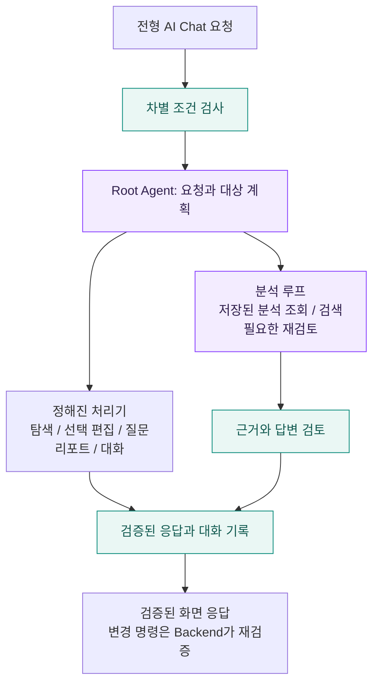
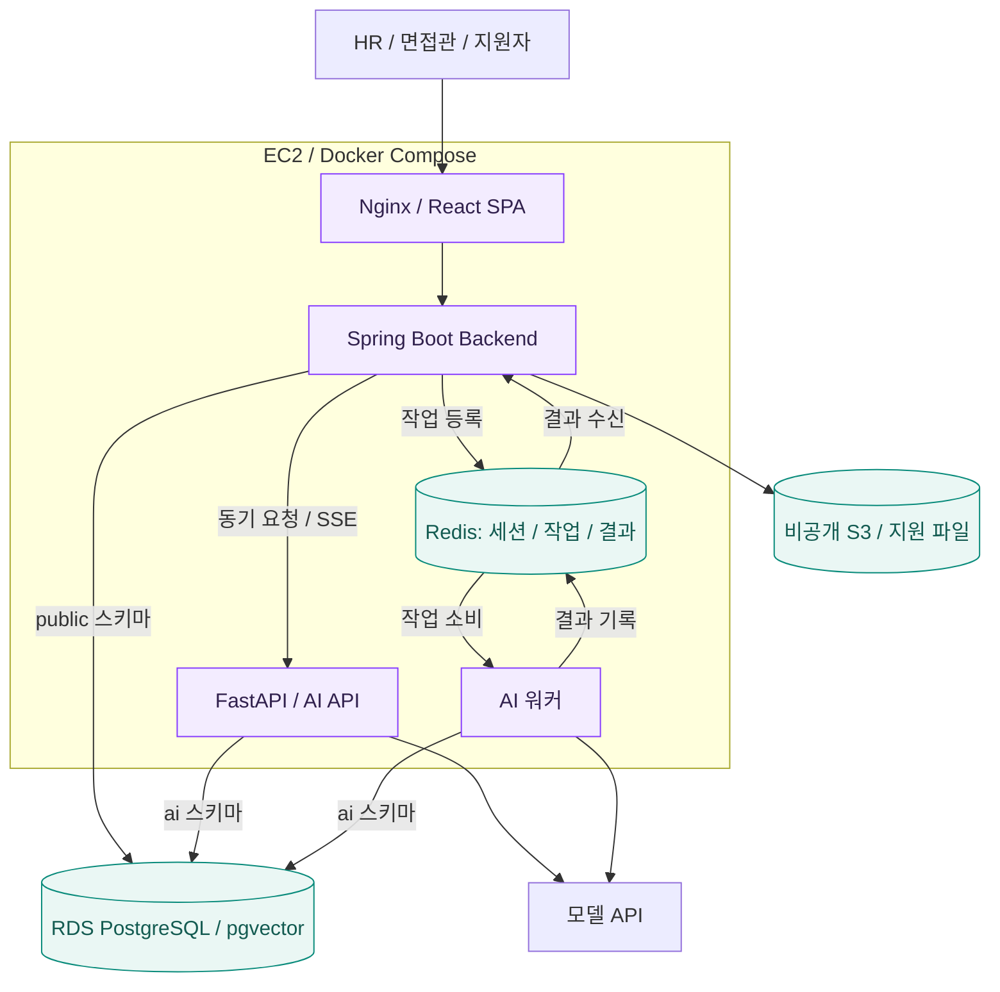

<div align="center">


# HireMate

### 채용의 반복 업무는 AI와 함께, 최종 결정은 담당자가.

공고 작성부터 지원자 분석, 면접 운영, 최종 리포트까지 연결하는<br />
**멀티에이전트 기반 E2E 채용 플랫폼**

<p>
  
  
  
  
</p>

[서비스 소개](#서비스-소개) / [주요 기능](#주요-기능) / [AI 설계](#멀티에이전트-설계) / [아키텍처](#시스템-아키텍처) / [시작하기](#시작하기)

</div>

---

## 서비스 소개

HireMate는 기업이 필요한 전형을 조합하고, 채용 담당자와 면접관이 같은 채용 흐름 안에서 일할 수 있도록 돕는 MVP다.
AI는 자료를 분석하고 후보를 탐색하며 초안을 작성한다. 담당자는 제시된 근거를 확인하고 채용 결정을 내린다.


> **반복적인 서류 검토를 줄이고, 담당자는 근거를 확인해 결정에 집중한다.**
> 합격과 불합격 결정, 전형 결과 확정, 공고 게시, 안내 발송은 담당자가 화면에서 직접 실행한다.

| 기존 업무의 어려움                                  | HireMate의 지원 방식                                      |
| --------------------------------------------------- | --------------------------------------------------------- |
| 지원 문서를 건별로 읽고 필요한 정보를 다시 정리한다 | 서류를 분석해 근거 문장이 포함된 지원자 프로필을 만든다   |
| 조건에 맞는 지원자를 찾기 위해 여러 자료를 오간다   | 전형별 AI Chat으로 후보를 탐색하고 근거와 출처를 확인한다 |
| 평가 결과와 면접 기록을 따로 대조한다               | 지원자별 전형 이력과 분석 결과를 함께 살펴본다            |
| 면접 질문과 안내 문구를 매번 작성한다               | 지원자별 질문과 안내 초안을 생성해 담당자가 검토한다      |

## 채용 흐름

**공고 작성 → 지원 접수 → 기업별 전형 운영 → 결과 확정과 안내 → 최종 리포트**

서류, 평가, 면접 등 필요한 전형을 조합한다. 다음은 서류와 면접을 포함한 운영 예시다.

| 단계        | 담당자가 하는 일                            | AI가 돕는 일                                          |
| ----------- | ------------------------------------------- | ----------------------------------------------------- |
| 공고 준비   | 채용 정보와 전형을 구성하고 공고를 게시한다 | 공고 본문과 포스터 디자인의 초안 및 수정안을 제안한다 |
| 지원 접수   | 제출 자료와 접수 현황을 확인한다            | 제출 문서를 분석하고 지원자 프로필을 갱신한다         |
| 전형 운영   | 기준과 근거를 확인해 지원자를 검토한다      | 후보 탐색, 평가 결과 분석, 확인할 점 정리를 돕는다    |
| 면접 진행   | 면접관을 배정하고 질문과 답변을 기록한다    | 맞춤 질문, 꼬리질문, 답변 분석을 제공한다             |
| 결과와 안내 | 전형 결과를 확정하고 안내를 발송한다        | 안내 문구와 최종 리포트의 초안을 작성한다             |

## 주요 기능

### 01. 공고 작성과 포스터 편집

AI와 대화하며 공고 초안을 작성하고 문구를 수정한다. 포스터 디자인을 제안받고 미리보기에서 검토한 뒤 적용한다.
웹 미리보기와 PDF는 같은 렌더러를 사용하며, Canva와 Templated 연동은 선택해서 설정할 수 있다.

### 02. 근거를 확인하는 지원자 분석

지원 문서, 평가 결과, 면접 답변을 분석해 지원자 정보를 정리한다.
분석 항목에는 근거 문장과 출처를 연결하고, 확인되지 않은 내용은 확인 필요로 남긴다.

### 03. 전형의 맥락을 아는 AI Chat

현재 채용과 전형의 지원자를 대상으로 질문하고 후보를 탐색한다.
선택 지원자 영역 편집과 면접 질문 생성을 요청할 수 있으며, 실제 변경은 Backend가 대상과 권한을 검증해 실행한다.
HR의 Chat 탭은 같은 기업 담당자가 공유하고, 면접관의 탭은 본인만 본다.

### 04. 담당 역할에 맞춘 면접 운영

인사와 실무 면접관을 배정하고 담당 질문, 답변, 꼬리질문과 개인 메모를 관리한다.
면접관은 배정된 지원자의 자료를 확인하고 자기 담당 질문에 답변을 기록한다.
자동 저장과 초안 복구로 기록을 이어가며, 저장 충돌이 생기면 최신 내용과 비교한다.

### 05. 안내 초안과 최종 리포트

담당자가 확정한 결과에 맞춰 안내 초안을 검토하고 발송한다.
전형별 분석과 지원자 비교 자료를 활용한 최종 리포트 초안으로 채용 과정을 돌아본다.

## 멀티에이전트 설계

Root Agent는 요청 종류와 지원자 범위를 계획하고 필요한 처리 경로를 고른다.
미리 정해진 작업은 처리기로 실행하고, 자료를 읽어야 다음 단계를 알 수 있는 요청은 분석 루프가 맡는다.
공고 작성과 포스터 대화는 공고 Agent가 직접 처리한다.



| Agent          | 책임                                                              |
| -------------- | ----------------------------------------------------------------- |
| Root           | 요청 계획, 대상 범위 해석, 탐색과 분석 조합, 근거 검토, 대화 기억 |
| 서류 분석      | 제출 문서 분석과 근거 확인, 지원자 프로필 갱신                    |
| 평가 분석      | 평가 결과와 제출물 분석                                           |
| 면접 분석      | 면접 답변 분석과 확인할 점 정리                                   |
| 공고 생성      | 공고 초안과 수정안, 포스터 디자인 제안                            |
| 면접 질문 생성 | 지원자 자료와 확인할 점에 맞춘 질문 생성                          |
| 안내 생성      | 담당자가 검토할 안내 초안 작성                                    |
| 리포트 생성    | 전형 결과와 지원자 비교를 활용한 리포트 초안 작성                 |

분석과 생성 Agent는 Python 함수로 기능을 공개한다. AI 서버 안에서 Agent끼리 HTTP로 호출하지 않는다.
자료가 들어올 때 워커가 미리 분석하고, Root는 저장된 분석을 읽어 조합한다.
분석이 없거나 재검토가 필요한 경우에만 하위 Agent를 다시 호출한다.

## 신뢰할 수 있는 AI 설계

| 원칙                              | 구현 방식                                                                          |
| --------------------------------- | ---------------------------------------------------------------------------------- |
| **담당자가 결정한다**             | AI에 합격과 불합격 결정, 결과 확정, 게시, 발송 도구를 제공하지 않는다              |
| **근거를 확인한다**               | 분석 근거가 원문에 있는지 확인하고, Root는 근거 번호를 인용해 출처를 연결한다      |
| **과장된 답을 낮추거나 제외한다** | 주장과 근거를 검토하고 확인이 부족한 항목은 확인 필요로 표시한다                   |
| **조회 범위를 제한한다**          | 현재 기업, 채용, 전형을 코드가 지정하고 면접관은 배정된 지원자만 조회한다          |
| **제출 자료와 지시를 구분한다**   | 문서와 URL 본문은 신뢰하지 않는 자료 블록으로 감싸며 도구 권한을 바꾸지 못한다     |
| **차별 조건을 차단한다**          | 나이, 성별, 출신 지역, 혼인 여부, 신체 조건을 이용한 탐색과 필터링 요청을 차단한다 |
| **검증 후 스트리밍한다**          | 화면에는 정해진 단계 문구와 검증을 마친 항목만 먼저 보낸다                         |

NCS는 담당자의 판단을 돕는 참고자료로 사용한다. 참고한 경우 검증된 출처를 별도로 보여주며,
NCS의 직무 설명을 지원자가 실제로 수행한 사실처럼 취급하지 않는다.

## 시스템 아키텍처

운영 환경에서 외부 요청은 Nginx로 들어온다. Backend는 업무 데이터와 권한, 상태 변경을 담당하고,
AI API는 화면에서 기다리는 요청을 처리한다. 시간이 걸리는 분석과 리포트 작업은 Redis 대기열로 워커에 맡긴다.



- **업무 데이터의 쓰기 주체는 Backend**다. AI는 지원자 프로필, 분석 결과, 호출 로그와 Chat 대화를 `ai` 스키마에 저장한다.
- **비동기 작업은 Redis Streams**로 전달한다. 워커는 결과 스트림에 응답하고 Backend가 결과를 반영한다.
- **지원 파일은 비공개 S3**에 보관하고 서명 URL로 접근한다. 로컬 개발에서는 로컬 파일 저장소를 사용한다.
- **DB 마이그레이션은 스키마별로 분리**한다. Backend의 `public` 스키마는 Flyway, AI의 `ai` 스키마는 Alembic으로 관리한다.

## 기술 스택과 저장소

| 영역                 | 주요 기술                                                      | 선택한 역할                                 |
| -------------------- | -------------------------------------------------------------- | ------------------------------------------- |
| Frontend             | React 19, TypeScript, Vite, Tailwind CSS, shadcn/ui            | HR 콘솔, 면접관 모드, 지원자 채용 페이지    |
| 클라이언트 상태와 폼 | TanStack Query, Zustand, React Hook Form, Zod                  | 서버 상태, 클라이언트 상태, 입력 검증       |
| Backend              | Java 25, Spring Boot 4, Spring Security, Spring Modulith, JPA  | 업무 API, 인증과 권한, 모듈 경계            |
| AI                   | Python 3.13, FastAPI, LangGraph, LangChain                     | 요청 계획, 분석과 생성, SSE 응답            |
| 데이터               | PostgreSQL 17, pgvector, Redis 8, S3                           | 업무 데이터, 벡터 검색, 세션과 대기열, 파일 |
| 인프라               | Docker Compose, Nginx, GitHub Actions, AWS EC2 / RDS           | 실행 환경과 CI/CD                           |
| 품질                 | Checkstyle, Vitest, ESLint, Ruff, mypy, pytest, Testcontainers | 코드 검사와 자동 테스트                     |

```text
HireMate/
├── frontend/              HR 콘솔, 면접관 모드, 지원자 페이지
│   └── src/
│       ├── app/           라우트와 공통 레이아웃
│       ├── pages/         사용자별 화면
│       ├── features/      업무 기능별 컴포넌트와 훅
│       └── lib/api/       API 클라이언트와 생성된 계약 타입
├── backend/               업무 서버와 권한 검증
│   └── src/main/
│       ├── java/com/hiremate/  업무별 모듈
│       └── resources/db/  Flyway 마이그레이션
├── ai/
│   └── src/hiremate_ai/
│       ├── agents/        Root, 분석, 생성 Agent
│       ├── llm/           공통 모델 클라이언트와 호출 기록
│       ├── db/            AI 스키마와 Alembic 마이그레이션
│       ├── ncs_search/    NCS 참고 검색과 질의 임베딩
│       └── worker/        비동기 작업 처리
├── contract/              Backend와 AI가 공유하는 JSON 계약 샘플
├── scripts/demo/          가상 지원자를 이용한 데모
├── compose.yaml           로컬 PostgreSQL, Redis, Mailpit
└── compose.production.yaml  운영 서비스 구성
```
