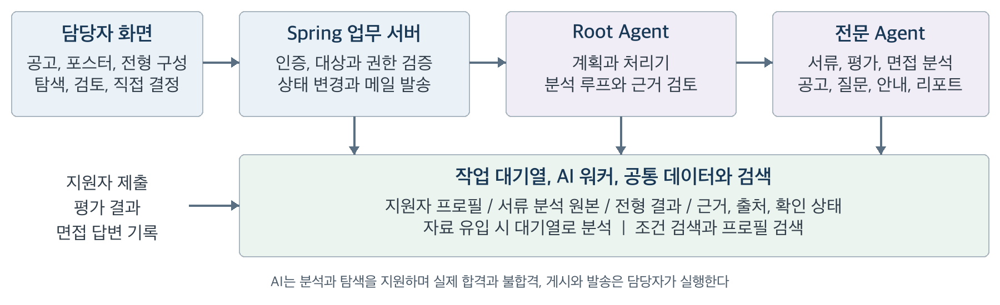

# 멀티에이전트 기반 E2E 채용 자동화 플랫폼
## 제품 요구사항 정의서

기업별 전형 구성과 대화형 지원자 탐색을 지원하는 Human in the Loop 채용 서비스

작성일 2026년 10월 29일 | 작성자 정유민 | 대상 기획 담당자, 개발 담당자, 프로젝트 검토자

### 1 문서 개요

본 문서는 기업이 필요한 전형을 조합하고, AI의 분석과 탐색 결과를 활용하여 채용을 운영하는 플랫폼의 제품 요구사항을 정의한다. 공고와 포스터 작성, 지원 접수, 전형 진행, 담당자의 결정, 결과 안내, 최종 리포트를 하나의 흐름으로 연결하는 것이 MVP의 목표다.

AI가 제안한 후보군과 담당자가 확정한 채용 결과를 구분한다. AI는 근거를 제공하고 작업을 보조하며, 전형의 합격과 불합격, 공고 게시와 안내 발송은 담당자가 직접 실행한다.

| 항목 | 내용 |
|---|---|
| 제품명 | 멀티에이전트 기반 E2E 채용 자동화 플랫폼 |
| 주요 사용자 | 기업 채용 담당자, 면접관, 지원자 |
| 핵심 가치 | 기업별 전형 구성, 근거 있는 서류 평가, 대화형 지원자 탐색, 전형 간 정보 활용, 사람의 직접 결정 |
| MVP 기간 | 한 달을 기준으로 핵심 채용 흐름 구현 |
| 기술 방향 | Spring 업무 서버, FastAPI AI 서버와 AI 워커, LangGraph Root Agent, 역할별 전문 Agent, 지원자 프로필과 검색 도구 |
| 운영 원칙 | AI 제안과 채용 결과 분리, 근거와 출처 제공, 담당자의 검토 후 게시와 발송 |

<!-- PAGE -->

### 2 문제 정의 및 목표

기업마다 필요한 전형의 종류와 순서가 다르며, 같은 기업도 직무에 따라 채용 절차가 달라진다. 고정된 절차에 맞춘 시스템은 이러한 차이를 반영하기 어렵다. 또한 지원 문서, 평가 결과, 과제, 면접 기록이 분리되면 담당자가 지원자를 비교하고 판단 근거를 확인하는 데 반복적인 검토가 필요하다.

본 서비스는 전형을 공통 구조로 구성하고, 자료가 들어올 때 지원자 프로필을 갱신한다. 서류는 공고의 자격 요건과 우대 사항으로 판정해 검토 순서를 제안한다. 담당자는 자연어로 후보군을 찾고 조건을 좁히며, AI가 제시한 근거를 확인한 뒤 직접 결과를 결정한다.

| 목표 | MVP 성공 기준 |
|---|---|
| 기업별 채용 절차 구성 | 전형 이름과 순서를 직접 또는 자연어로 정하고 서류, 평가, 면접 유형으로 구성한다. |
| 근거 있는 서류 검토 | 공고 기준별 판정과 근거로 서류 점수와 검토 순서를 제안하고, 확인이 필요한 항목은 보류로 구분한다. |
| 지원자 탐색 효율 향상 | 조건에 맞는 후보군을 리스트에 표시하고 추가, 좁히기, 빼기, 직접 편집을 지원한다. |
| 전형 간 정보 연결 | 지원 자료, 평가 결과, 면접 기록을 누적하고 서로 다른 자료의 근거를 함께 제시한다. |
| 담당자의 통제 유지 | AI 탐색은 채용 상태를 바꾸지 않으며 합격과 불합격은 담당자 버튼 조작으로만 결정한다. |
| 채용 업무의 연결 | 공고부터 안내 발송과 최종 리포트까지 하나의 채용 흐름을 완료한다. |

### 3 사용자 및 핵심 시나리오

| 사용자 | 주요 업무 | 대표 시나리오 |
|---|---|---|
| 채용 담당자 | 가입, 설정, 공고와 포스터, 전형 구성, 검토, 결정, 안내 | 공고 작성 → 포스터 → 게시 → AI 탐색 → 직접 결정 → 안내 → 종료 |
| 면접관 | 질문 확인, 질문 추가, 답변 기록, 메모 | 이전 전형 확인 → 맞춤 질문 확인 → 면접 진행 → 질문별 답변 기록 |
| 지원자 | 공고 확인, 동의, 지원서 제출 | 자체 채용 페이지 확인 → 필수 자료 제출 → 접수 확인과 결과 안내 수신 |

MVP에서는 채용 담당자 계정이 면접 질문과 답변을 기록한다. 면접관 전용 화면, 계정 구분과 열람 범위는 부록의 확정 필요 항목으로 관리한다. 관리자용 정책 관리 화면은 현재 MVP 화면 범위에 포함하지 않는다.

<!-- PAGE -->

### 4 범위

#### 4 1 포함 범위

- 기업 가입과 채용 담당자 로그인
- 회사 소개, 채용 공고 양식, 포스터 템플릿, 안내 메일 꾸밈과 양식 등록, PDF 참고 자료 관리
- 기업 양식을 이용한 공고 작성, NCS 근거 자격 요건과 우대 사항 초안, AI 수정안의 칸별 적용
- 전형 구성의 직접 편집과 자연어 요청, 전형별 안내 작성
- 공고 포스터 디자인과 AI 디자인 수정, 자체 채용 페이지 게시
- 공통 지원서, 필수 제출 항목 검증, 접수 확인 메일
- 지원 자료 사전 분석, 공고 기준 판정과 서류 점수, 근거와 확인 상태가 포함된 지원자 프로필
- 서류, 평가, 면접에 공통으로 사용하는 전형 화면
- 자연어 지원자 탐색, 분석, 비교와 선택 지원자 편집
- 외부 평가 결과와 과제 제출물 등록 및 해석
- 지원자별 면접 질문 생성과 근거 표시, 질문별 답변 기록과 답변 분석
- 담당자의 개별 및 일괄 결정과 전형 결과 확정
- 기업 양식 기반 안내 초안, 담당자 검토 및 이메일 발송
- 채용 종료 후 문서형 최종 채용 리포트 생성

#### 4 2 제외 범위

| 구분 | MVP에서 제외하는 기능 |
|---|---|
| 지원자 유입 | 외부 채용 플랫폼 자동 게시, 직접 소싱, 헤드헌팅 |
| 자체 평가 | 검사 시스템, 코딩테스트 플랫폼, AI 영상면접, 면접 영상 및 녹취 분석 |
| 외부 연결 | 모든 평가 업체 API 연동, 자동 면접 일정 조율 |
| 입사 이후 | 전자계약, 급여, HRIS 연동, 복잡한 온보딩 |
| 분석 및 탐색 UI | 고도화된 채용 Analytics, 자료 위치로 이동하는 출처 칩 |

외부 평가는 업로드와 수동 입력으로 결과를 가져온다. 출처는 텍스트로 제공하며, 최종 리포트는 차트 중심 대시보드가 아닌 요약 문서로 제공한다.

#### 4 3 범위 적용 원칙

공고는 항상 첫 단계이며 지원자를 평가하는 Stage와 구분한다. 이후에는 필요한 전형만 선택하고 같은 유형을 여러 번 사용할 수 있다. 예를 들어 공고 → 면접, 공고 → 서류 → 평가, 공고 → 서류 → 평가 → 평가 → 면접 → 면접을 모두 표현할 수 있다.

게시한 공고의 내용과 전형 절차는 바꾸지 않으며, 전형별 안내만 채용 종료 전까지 고칠 수 있다. 결과 확정 취소와 리포트 외부 공유 정책은 부록의 확정 필요 항목으로 관리한다.

<!-- PAGE -->

### 5 전체 시스템 구조

| 계층 | 주요 구성 | 책임 |
|---|---|---|
| 사용자 화면 | 로그인, 대시보드, 설정, 공고와 포스터 편집, 채용 페이지와 지원서, 공통 전형, 종료와 안내, 리포트 | 자료 입력, 탐색 결과 표시, 담당자 결정과 게시 및 발송 |
| 업무 서버 | Spring 서버 | 인증, 채용과 전형 데이터 관리, 대상 및 권한 검증, 선택 편집과 결과 변경, 메일 발송 실행 |
| 작업 대기열 | Redis 작업 대기열과 AI 워커 | 화면이 기다리지 않는 분석과 생성 작업을 맡기고 결과를 업무 서버에 돌려준다 |
| 요청 조율 | Root Agent | Chat 요청의 종류와 대상을 계획하고 처리기 또는 분석 루프로 실행한 뒤 근거를 검토한다 |
| 전문 처리 | 분석 Agent와 생성 Agent | 자료 분석 및 프로필 갱신, 공고와 포스터, 질문, 안내, 리포트 초안 생성 |
| 공통 기반 | 지원자 프로필, 서류 분석 원본, NCS 자료, 조건 및 프로필 검색 | 누적 정보를 검색하고 근거 문장과 출처, 확인 상태를 제공 |

자료가 들어오는 시점에는 업무 서버가 작업을 대기열에 넣고 AI 워커의 분석 Agent가 프로필을 갱신한다. 실패한 작업은 분석 실패로 남아 담당자가 다시 요청할 수 있다. Chat 요청은 Root Agent가 계획 한 번으로 종류와 대상 범위를 정한다. 찾기, 편집, 일반 대화, 되묻기, 차단과 결정 안내는 정해진 처리기가, 분석과 확인할 점이 필요한 면접 질문은 좁은 분석 루프가 처리한다. 선택 편집과 면접 질문 생성은 Root Agent가 구조화된 명령으로 내고 서버가 검증하여 실행한다.

### 6 Agent 설계

| Agent | 실행 계기와 책임 | 주요 출력 |
|---|---|---|
| Root Agent | Chat 요청의 계획, 처리기와 분석 루프 실행, 근거 검토 | 실행 계획, 근거를 포함한 통합 응답, 선택 편집과 면접 질문 명령 |
| Application Agent | 지원 접수 시 AI 워커에서 실행, 요청 시 서류 재검토 | 공고 기준별 판정, 서류 점수와 보류, 자기소개서 문항별 요약, 근거와 확인 상태 |
| Assessment Agent | 평가 결과 및 과제 등록 시 AI 워커에서 실행 | 평가 자료와 메모의 강점과 약점, 근거 |
| Interview Agent | 결과 확정 시 질문 생성, Chat 요청, 답변 기록 시 분석 | 질문 유형과 근거가 붙은 맞춤 질문, 답변에서 확인된 점과 미확인 사항 |
| Posting Agent | 공고와 포스터 화면의 AI 수정 요청 | 칸별 수정안, NCS 근거 자격 요건과 우대 사항, 전형 이름과 유형, 필수 제출 서류, 포스터 디자인 추천 |
| Communication Agent | 안내 초안 화면에서 그룹별 작성과 수정 요청 | 기업 양식의 AI 작성 영역 초안 |
| Report Agent | 채용 종료 시 AI 워커에서 실행 | 전형별 인원, 최종 합격자의 판단 근거, 전형 간 특이사항 요약 |

동일한 모델에 역할별 지시문, 도구, 출력 형식을 달리 적용한다. 화면에서 직접 요청한 공고와 포스터 수정, 안내 작성은 해당 Agent를 호출하며, AI Chat 요청은 Root Agent가 조율한다. Root Agent는 원문을 직접 해석하지 않고 분석 Agent가 정리한 결과를 읽어 조합하며, 채용 상태를 변경하지 않는다. 생성 Agent는 초안만 만들고 게시나 발송을 수행하지 않는다.

<!-- PAGE -->

### 7 기능 요구사항

우선순위 Must는 MVP 완료에 필요한 기능, Should는 핵심 흐름 완료 후 적용할 보완 기능이다. 정책이 필요한 항목은 부록의 MVP 기본값과 확정 필요 항목을 함께 확인한다.

#### 7 1 채용 준비 및 지원 접수

| ID | 기능 | 요구사항 | 우선순위 |
|---|---|---|---|
| FR-36 | 기업 가입과 로그인 | 가입하면 기업과 첫 채용 담당자 계정을 함께 만든다. 이메일과 12자 이상 비밀번호로 로그인하며, 로그인하지 않으면 담당자 화면에 들어갈 수 없다. 로그아웃은 확인 후 실행한다. | Must |
| FR-01 | 기업 설정 | 설정은 회사 소개, 채용 공고, 안내 메일의 세 영역으로 구성한다. 회사 소개, 조직 문화, 인재상, 복지, PDF 참고 자료, 공고 Template, 작성 스타일, 필수 안내 문구, 기존 채용공고, 포스터 템플릿, 메일 꾸밈과 양식 5종을 등록한다. | Must |
| FR-02 | 공고 초안 | 기업 공고 양식으로 편집 화면을 열고 회사 소개, 복지, 필수 안내 문구를 채운다. 채용명, 직무, 고용 형태, 경력, 근무지, 모집 조건, 주요 업무, 자격 요건, 우대 사항은 직접 또는 AI 요청으로 작성한다. AI는 NCS 능력단위를 근거로 자격 요건과 우대 사항을 근거가 있는 만큼 쓴다. | Must |
| FR-03 | AI 수정안 | AI가 바꾼 칸을 표시하고 칸마다 적용하거나 되돌린다. 담당자가 고른 줄만 고치는 요청을 지원한다. 수정안이 남아 있으면 다음 단계로 넘어가지 않는다. 전형 절차, 필수 제출 서류, 유의사항은 고정 칸으로 구분하며 담당자의 편집이나 요청으로만 바꾼다. | Must |
| FR-04 | 전형 구성 | 전형 추가, 삭제, 이름과 유형 변경, 끌어서 순서 변경, 아이콘 선택을 직접 지원하고 같은 변경을 자연어로도 요청한다. 이름을 유지하고 DOCUMENT, ASSESSMENT, INTERVIEW 유형으로 분류한다. 모호한 유형은 되묻는다. | Must |
| FR-34 | 전형별 안내 | 전형마다 일정, 진행 방식, 장소 또는 접속 링크, 준비 사항, 기타 안내를 적는다. 일정은 앞뒤 전형 사이로 제한한다. 게시 후에도 채용 종료 전까지 고칠 수 있으며 이미 보낸 안내가 있으면 확인을 받는다. | Must |
| FR-33 | 공고 포스터 | 공고 본문으로 포스터를 만든다. 템플릿, 색상, 장식, 로고, 전형 아이콘을 고르고 여러 직무는 직무별 표로 보여 준다. AI 디자인 수정안은 미리보기 후 적용하며 공고 내용을 바꾸지 않는다. 게시 여부를 정하고 PDF로 내보낸다. | Must |
| FR-05 | 공고 게시 | 채용 페이지를 PC와 모바일 모양으로 미리 보고 접수 기간을 정한다. 공고명, 공고 기간, 채용 요약, 전형 절차를 확인한 뒤 담당자가 게시한다. 비어 있는 전형별 안내를 알린다. 게시하면 공고 내용과 전형 절차를 잠그고 자체 채용 페이지를 연다. | Must |
| FR-35 | 접수 확인과 접수 현황 | 지원서를 제출하면 지원번호를 담은 접수 확인 메일을 설정의 양식 그대로 보낸다. 접수 현황 화면에서 지원자 수, 남은 기간, 최근 지원자를 보고 접수를 마감한다. 기간 종료나 마감 시 첫 전형을 시작한다. | Must |
| FR-06 | 공통 지원서 | 이름, 이메일, 연락처, PDF 이력서와 자기소개서, 개인정보 동의와 AI 활용 안내 확인을 필수로 받는다. 자격증 텍스트와 PDF 포트폴리오는 기본 선택 항목이다. 같은 이메일의 중복 지원과 접수 기간 밖의 제출을 막는다. | Must |
| FR-07 | 필수 항목 검증 | 공고에서 추가로 요구한 서류를 지원서의 필수 항목으로 반영한다. 누락되면 제출을 막고 해당 항목으로 이동한다. | Must |
| FR-08 | 자료 사전 분석 | 지원 접수 시 작업 대기열로 Application Agent를 실행해 공고 기준별 판정, 서류 점수, 자기소개서 문항별 요약, 근거와 출처, 확인 상태를 프로필에 저장한다. 실패하면 분석 실패로 표시하고 다시 분석할 수 있다. | Must |
| FR-09 | 채용 대시보드 | 상태별 탭과 채용명 검색을 제공한다. 진행 상태와 전형 흐름을 표시하고 종료된 전형은 회색으로 구분한다. 채용을 누르면 지금 단계로 이동하며 로고로 대시보드에 돌아온다. | Must |

<!-- PAGE -->

#### 7 2 전형 화면과 대화형 탐색

| ID | 기능 | 요구사항 | 우선순위 |
|---|---|---|---|
| FR-10 | 공통 전형 화면 | 전형 단계 줄, 전체 지원자, 선택 지원자 또는 지원자 카드, AI Chat의 3단 구조를 사용한다. 단계별 인원과 결정 현황, 결과 확정 버튼을 표시하고 경계선으로 칸 너비를 조절한다. | Must |
| FR-11 | 지원자 카드 | 서류는 프로필과 AI 분석, 제출 문서와 근거 밑줄, 자기소개서 문항별 요약을 보여 준다. 평가는 결과와 제출물, 면접은 맞춤 질문과 답변 기록을 보여 준다. 이전 전형 결과와 메모를 확인한다. | Must |
| FR-12 | Chat 대상 지정 | 현재 채용과 전형을 기본 범위로 사용한다. @멘션을 입력창 칩으로 넣고 해제할 수 있으며 체크한 지원자와 앞 대화의 결과를 가리킬 수 있다. 대상이 없으면 현재 전형 전체 지원자를 기준으로 한다. | Must |
| FR-13 | 요청 조율 | Root Agent가 계획 한 번으로 찾기, 분석, 면접 질문, 선택 편집, 일반 대화, 되묻기, 차단, 결정 안내를 구분하고 대상 범위를 정한다. 정해진 처리기 또는 분석 루프로 실행하고 근거를 검토한 뒤 응답한다. | Must |
| FR-14 | 자연어 탐색 | 경력 연수, 서류 점수, 평가 총점, 평가 영역 점수, 등급, 결정 상태, 공고 기준, 인재상 조건과 프로필 검색으로 후보를 좁힌 후 근거를 재확인한다. 결과를 리스트의 AI 표시, 선택 지원자 영역, Chat 요약에 함께 반영한다. | Must |
| FR-15 | 탐색 결과 편집 | 찾아줘는 새 결과로 교체하고 이전 선택으로 되돌릴 수 있다. 추가해줘는 기존 결과에 더하며 그중이라는 요청은 현재 선택 안에서 좁힌다. 빼줘는 현재 선택 안에서 조건에 맞는 사람을 뺀다. | Must |
| FR-16 | 직접 넣기와 빼기 | 리스트와 선택 카드의 +와 -, 되돌리기와 비우기로 편집한다. Chat의 편집 명령은 서버가 대상과 권한을 검증한 후 실행하며, 이미 결정한 지원자는 이유와 함께 제외한다. 빼기는 불합격 처리가 아니다. | Must |
| FR-17 | 대화형 분석 | 특정 지원자 의견과 비교는 근거 및 출처와 함께 답한다. 여러 전형 자료가 필요하면 모두 확인한다. 설명 요청으로 후보군을 바꾸지 않는다. 없는 자료를 근거로 결과를 만들지 않으며 아직 진행하지 않은 전형의 자료를 부족한 점으로 말하지 않는다. | Must |
| FR-18 | 리스트 표시 | 이름, 경력 연수와 마지막 회사 또는 신입을 표시한다. 서류 전형은 총점, 영역 점수, 채우지 못한 자격요건을, 평가 전형은 평가 총점을, 면접 전형은 면접 일정을 붙인다. 결정 상태로 거르고 검색하며 스크롤로 이어 불러온다. | Must |
| FR-37 | Chat 진행과 대화 기록 | 처리 단계를 정해진 문구로 쌓아 보이고 검증을 마친 항목을 먼저 보낸다. 답에는 처리 과정을 접어 붙인다. 대화는 담당자별, 전형별로 보관하고 전형이 끝나면 삭제하며 지원 문서 원문은 담지 않는다. | Must |

대상이 모호한 편집 요청은 실행 전에 되묻는다. 선택 지원자에 넣는 동작과 합격 또는 불합격 결정은 별개로 처리한다. AI Chat의 채용 결과 변경 요청은 합격 및 불합격 버튼을 안내하며 실행하지 않는다.

<!-- PAGE -->

#### 7 3 검토 표시와 담당자 결정

| ID | 기능 | 요구사항 | 우선순위 |
|---|---|---|---|
| FR-38 | 서류 평가 기준 | 공고의 자격 요건과 우대 사항을 평가 항목으로 쓴다. 항목마다 유형(조건형, 단일 능력과 경험형, 복합 경험형)과 판정 기준을 두고 선발 인원을 정한다. 사람이 확정하며 AI는 항목과 유형을 바꾸지 않는다. | Must |
| FR-19 | 서류 검토 순서 | 판정은 충족, 부분 충족, 미충족, 확인 필요다. 자격요건 50점과 우대사항 50점으로 계산하고 확인 필요가 남으면 총점을 보류한다. 자격요건 순을 기본으로 총점 순을 지원한다. AI 추천은 굵게, 추천 밖은 회색, 보류는 연한 회색 배경으로 표시한다. | Must |
| FR-20 | 추천 밖 지원자 검토 | AI 추천은 자격요건 75% 이상이고 보류가 아닌 지원자 중 선발 인원 10배수까지이며 동점자를 포함한다. AI 탐색은 추천 밖 지원자를 제외한다. 담당자는 ↑로 추천에 올린 뒤 +로 선택 영역에 넣을 수 있다. ↑만으로 선택하거나 합격 처리하지 않는다. | Must |
| FR-21 | AI와 결정 표시 | AI Chat으로 선택 영역에 넣은 지원자는 결정 색과 겹치지 않는 보라색 테두리로, 직접 추가는 테두리 없이 표시한다. 미결정은 흰색, 합격은 연한 초록, 불합격은 연한 빨강 배경을 사용한다. | Must |
| FR-22 | 일괄 결정 | 체크박스와 전체 선택으로 검토 대상을 정하고 하단 합격 또는 불합격 버튼으로 결정한다. 체크가 없으면 열어 둔 지원자 카드를 대상으로 한다. 대상 인원 또는 이름을 표시하고 대상이 없으면 버튼을 비활성화한다. | Must |
| FR-23 | 결정 반영과 복구 | 결정은 확인 창 없이 반영하고 방금 한 결정을 알림에서 되돌릴 수 있다. 결정자는 선택 영역에서 빠지고 전체 리스트에 남는다. 복구하면 선택 영역으로 돌아온다. | Must |
| FR-24 | 전형 결과 확정 | 확정 전에 합격과 불합격 인원 및 미결정 포함 인원을 확인한다. 합격자만 다음 전형 대상이 되며 나머지와 미결정자는 불합격으로 확정한다. 다음 전형이 면접이면 합격자의 질문을 미리 만든다. 확정 후에는 결정과 선택 편집을 하지 않는다. | Must |

#### 7 4 표시 규칙

AI 선택 테두리는 선택 영역에 있는 동안 유지한다. 선택 영역에서 제거하거나 새 탐색으로 교체하거나 결과를 결정하면 테두리를 제거한다. 이미 선택 영역에 있던 지원자도 Chat으로 다시 고르면 테두리를 붙인다. AI 선택과 직접 추가를 설명하는 글자 라벨, 결정 상태 칩, 결정 아이콘은 카드에 추가하지 않는다.

AI 추천은 담당자의 검토 순서를 돕는 표시다. 추천 밖이라는 이유로 자동 불합격 처리하지 않으며 담당자는 전체 지원자의 자료를 확인할 수 있다. 채우지 못한 자격요건 표시는 불합격 표시가 아니다. 합격과 불합격 버튼은 화면 하단에 두고 선택 카드와 지원자 카드 안에 중복 배치하지 않는다.

<!-- PAGE -->

#### 7 5 평가와 면접 및 채용 마무리

| ID | 기능 | 요구사항 | 우선순위 |
|---|---|---|---|
| FR-25 | 외부 평가 등록 | CSV 또는 XLSX 결과표, 지원자별 결과 파일, 총점과 등급 및 평가 메모 수동 입력, 과제 파일 또는 URL 등록을 지원한다. 이메일이나 지원번호로 대상자를 연결하고 등록 전에 매칭 결과를 보여 주며, 맞추지 못한 행은 직접 연결하거나 제외한다. | Must |
| FR-26 | 평가 해석 | 결과표 열을 전형 결과 항목에 연결한다. 직무역량 평가는 NCS 기준 5개 영역(의사소통능력, 수리능력, 문제해결능력, 정보능력, 기술능력) 점수와 총점, 등급을 관리한다. Assessment Agent가 강점과 약점을 프로필에 더하며 점수와 등급은 바꾸지 않는다. | Must |
| FR-27 | 맞춤 면접 질문 | 1차 면접은 자기소개와 핵심 질문 3개, 최종 면접은 자기소개와 핵심 질문 5개로 만든다. 질문마다 유형과 근거를 보여 준다. AI Chat으로 더 만들기, 교체, 메모 반영을 요청하고 화면에서 전체 재생성한다. 교체는 답변 없는 AI 질문만 지운다. | Must |
| FR-28 | 면접 답변 기록 | 질문별 답변 기록, 직접 질문 추가, 면접 일시와 면접관 입력을 지원한다. 이전 면접의 질문과 답변을 다음 면접 질문 위에 보여 주고 Interview Agent가 답변을 분석해 프로필에 확인 및 미확인 사항을 더한다. | Must |
| FR-29 | 결과 안내 | 확정 결과의 합격과 불합격 그룹마다 기업 양식 안에서 안내 초안을 만든다. 다음 전형 안내에는 전형별 안내를, 최종 합격 안내에는 입사 안내를 붙인다. 필수 문구를 보존하고 직접 편집 또는 AI 수정안 적용, 보낼 모습 미리보기를 지원한다. 담당자가 검토 후 이메일로 발송하고 실패한 대상은 다시 보낸다. | Must |
| FR-30 | 전형 및 채용 종료 | 결과 확정 → 안내 발송 → 전형 종료의 순서를 사용하며 안내를 모두 보내야 종료한다. 마지막 전형의 합격자를 최종 합격자로 확정하고 최종 안내 후 채용을 종료한다. | Must |
| FR-31 | 최종 리포트 | 채용 종료 시 Report Agent가 전형별 인원과 결과, 최종 합격자의 판단 근거와 출처, 전형 간 특이사항을 요약한다. 인원은 업무 서버 값을 그대로 쓰고 생성 기준 시점을 표시하며 채용 상태를 변경하지 않는다. | Must |
| FR-32 | 보완 인터랙션 | 선택 지원자 드래그앤드롭 등 조작 편의 기능은 핵심 흐름을 완성한 뒤 검토한다. | Should |

모든 면접 전형은 같은 화면을 사용한다. 지원 자료 탭에서는 서류 전형과 같은 프로필, 문서와 AI 분석을 확인한다. 안내 발송 후 전형을 종료하고 합격자를 대상으로 다음 전형을 시작한다.

<!-- PAGE -->

### 8 AI 통제 및 검증 요구사항

이 절의 통제는 제품 동작의 경계를 정의한다. 별도의 AI Gateway 제품이나 정책엔진은 도입하지 않고, 모델 호출 공통 구현과 업무 서버의 검증으로 경계를 지킨다.

| 구분 | 요구사항 |
|---|---|
| 조회 범위 | 현재 기업, 채용, 전형과 지정된 지원자를 기준으로 조회한다. 조회 범위는 도구 인자가 아니라 코드가 실행 context로 넣는다. 다른 기업의 데이터는 검색 대상에 포함하지 않는다. |
| 근거 검증 | 분석 Agent가 낸 근거 문장은 원문에 있는지 확인하고 없으면 버린다. Root Agent는 근거를 번호로 인용하고 코드가 원문 문장과 출처를 붙인다. 프로필 검색 후 후보의 근거를 재확인한다. |
| 근거 검토 | 항목 상태는 인용한 근거가 받쳐 줄 수 있는 상태를 넘지 않는다. 팀 성과와 역할이 불분명한 사실, 미확인과 상충 항목, 면접관 메모는 확인 필요로 둔다. 근거보다 세게 말한 문장은 낮추고 무관한 문장은 버린다. |
| 미확인 정보 | 자료가 없거나 근거가 부족하면 그 사실을 구분하여 표시한다. 미확인 정보를 사실로 채우지 않는다. 서류 판정의 확인 필요는 점수로 바꾸지 않고 보류한다. |
| 차별 조건 | 나이, 성별, 출신 지역, 혼인 여부, 신체 조건 등 부적절한 조건의 탐색을 차단하고 안내한다. 원 요청, 검색에 넘기는 조건, 면접 질문에 같은 검사를 적용한다. 구체적인 목록과 문구는 법무 검토 후 확정한다. |
| 실행 경계 | AI가 서버에 보내는 변경 명령은 선택 지원자 편집과 면접 질문 생성, 교체 요청뿐이다. 합격과 불합격 결정, 결과 확정, 게시와 발송을 AI가 독자적으로 수행하지 않는다. |
| 외부 문서 | 제출 문서, URL 본문, 평가 메모는 분석 자료로 감싸 넣는다. 문서 안의 지시문으로 도구 권한이나 채용 상태가 바뀌지 않도록 검증하며 분석 Agent에는 쓰기 도구를 주지 않는다. |
| 분석 루프 | 조회 도구와 분석 Agent만 쓴다. 요청 하나의 모델 호출 예산을 계획, 분석 루프, 재확인, 하위 Agent, 근거 검토가 함께 쓰며 최종 답과 근거 검토 호출을 남긴다. |
| 화면 전송 | 화면에는 코드가 정한 단계 문구와 검증을 마친 항목만 보낸다. 형식 오류, 검증 실패, 호출 예산 초과는 원인을 구분해 기록하고 각각에 맞는 안내를 보낸다. 내부 오류와 검증되지 않은 모델 출력은 노출하지 않는다. |

### 9 Human in the Loop

| 작업 | 처리 정책 | 담당자의 개입 |
|---|---|---|
| 자료 분석과 프로필 갱신 | 자료 유입 시 작업 대기열로 자동 분석 | 근거 및 원문 검토, 실패 시 다시 분석 |
| 공고, 포스터와 안내 초안 | AI가 수정안 또는 초안 생성 | 칸별 확인과 적용, 게시 또는 발송 |
| 지원자 탐색 | 선택 영역과 화면 표시만 변경 | 후보군 확인과 직접 편집 |
| 선택 지원자 넣기와 빼기 | 대상과 권한 검증 후 실행 | 확인 창 없이 편집, 모호한 대상은 재질문 |
| 면접 질문 | 결과 확정과 Chat 요청 시 생성 | 질문 확인, 직접 추가, 재생성, 답변 기록 |
| 합격과 불합격 결정 | 체크 또는 열어 둔 카드에 하단 버튼으로 처리 | 담당자 직접 실행, 직후 되돌리기 |
| 전형 결과 확정 | 미결정자를 포함한 인원 확인 | 확인 창에서 확정 |
| 안내 및 종료 | 확정 결과 기반 그룹별 초안 생성 | 초안 검토와 발송 후 전형 또는 채용 종료 |

개별 결정의 되돌리기와 전형 결과 확정 이후의 취소는 서로 다른 기능이다. 후자는 MVP에서 제공하지 않으며 허용 시점과 권한은 별도로 정한다.

<!-- PAGE -->

### 10 도구 인터페이스 설계

Agent와 업무 서버 사이의 연동과 Root Agent의 조회 도구다. 업무 서버는 ai 서버의 POST /agents/{agent}/{method}를 부르고 요청 본문은 Agent 메서드의 매개변수 이름을 키로 한 JSON이다. 화면이 기다리지 않는 작업은 같은 이름의 작업 유형으로 대기열에 넣는다. 조회 및 생성과 상태 변경 실행을 분리한다.

| 도구 | 분류 | 역할과 실행 경계 |
|---|---|---|
| root/plan | 조율 | Chat 요청의 계획과 처리, 진행 단계와 검증된 항목을 SSE로 보내고 마지막에 실행 계획을 담는다 |
| application/analyze | 분석 | 지원 문서의 공고 기준 판정, 서류 점수와 프로필 생성 (작업 대기열) |
| assessment/analyze | 분석 | 평가 결과와 과제, 평가 메모 해석 및 프로필 갱신 (작업 대기열) |
| interview/questions | 생성 | 이전 전형 정보를 바탕으로 맞춤 질문 생성 (결과 확정 시 작업 대기열, Chat 요청 시 직접) |
| interview-analyst/analyze | 분석 | 기록된 면접 답변 분석 및 프로필 갱신 (작업 대기열) |
| posting/revise, posting/design | 생성 | 공고 칸별 수정안, 포스터 디자인 추천 |
| communication/write | 생성 | 안내 양식의 AI 작성 영역 초안 |
| report/write | 생성 | 채용 종료 결과의 문서형 요약 (작업 대기열) |
| read_candidates | 조회 | 지원자 프로필, 저장된 서류 분석 원본, 면접 질문과 답변 |
| review_documents, review_interview | 분석 | 저장된 분석이 없거나 재검토가 필요할 때 서류와 면접 Agent 실시간 호출 |
| search_candidates | 조회 | 채용 및 전형 범위의 조건 검색과 프로필 검색, 근거 재확인 |
| stage_overview, company_and_posting, previous_turns | 조회 | 전형 집계, 회사 소개와 공고, 앞 대화의 검증된 항목 |

분석 루프에는 조회 도구와 분석 Agent만 주고 선택 편집 도구는 제공하지 않는다. 선택 편집과 면접 질문 생성은 실행 계획의 명령으로 내고 업무 서버가 검증해 실행한다. 게시, 합격과 불합격 변경, 결과 확정, 실제 안내 발송은 담당자의 화면 조작을 받는 업무 API에서 실행한다. 위 도구에 자동 채용 결정 기능을 부여하지 않는다.

### 11 데이터 요구사항

| 데이터 영역 | 주요 데이터 | 관리 요구사항 |
|---|---|---|
| 기업과 계정 | 기업, 채용 담당자 계정과 역할 | 기업별 분리, 모든 요청에서 소속 기업 확인 |
| 기업 설정 | 회사 소개, 인재상, 양식, 필수 문구, PDF, 포스터 템플릿, 메일 꾸밈 | 공고, 포스터, 안내 생성 시 참조 |
| 채용 및 전형 | 공고, 모집 조건, 접수 기간, 포스터 디자인, 전형 이름과 유형 및 순서, 전형별 안내 | 게시 내용과 전형 구성을 일치시켜 관리, 게시 후 잠금 |
| 지원서와 원문 | 기본 정보, 동의, PDF, 자격증, 추가 서류 | 필수 항목 검증, 원문과 분석 결과 연결 |
| 서류 평가 | 평가 기준과 버전, 항목별 판정과 근거, 서류 점수, 보류 여부 | 기준 버전이 바뀌면 저장된 결과를 다시 쓰지 않음 |
| 지원자 프로필 | 경험, 역량, 분석 요약, 확인 상태, 정리한 Agent | 항목별 근거 문장, 출처, 갱신 시점 관리 |
| 전형 결과 | 평가 지표와 메모, 과제, 질문과 근거, 답변, 면접 일정, 담당자 결정과 메모 | 전형별 분리, 이전 전형의 기록 보존 |
| 안내와 리포트 | 초안, 입사 안내, 발송 현황, 최종 요약 | 확정 결과와 대조, 대상별 발송 결과와 생성 기준 시점 기록 |
| 작업과 AI 로그 | 분석 작업과 결과, 모델 호출 기록 | 실패 원인과 재시도 기록, 호출별 비용과 시간 추적 |
| AI Chat 대화 | 담당자의 질문, 멘션한 지원자, 검증된 답과 항목, 결과 순서, 확인할 점, 처리 단계와 걸린 시간 | 담당자별, 전형별로 보관하고 전형이 끝나면 삭제, 지원 문서 원문은 담지 않음 |

업무 데이터(지원자 상태와 결정 이력)는 업무 서버만 쓴다. AI 서버는 지원자 프로필, 분석 결과, AI 호출 로그, Chat 대화만 별도 스키마에 저장한다. 지원자 정보의 보관 기간, 파기 절차, 면접관 열람 범위와 리포트 공유 범위는 운영 전 확정한다.

<!-- PAGE -->

### 12 비기능 요구사항

다음은 핵심 기능을 운영하기 위한 품질 요구사항이다. 성능 수치, 재시도 횟수와 보존 기간은 구현 및 부하 검증 후 확정하며, 현재 달성한 성과로 표현하지 않는다.

| ID | 영역 | 요구사항 |
|---|---|---|
| NFR-01 | 접근 통제 | 로그인한 담당자의 기업 및 채용 단위로 데이터 소유권을 확인한다. AI 명령과 사용자 요청 모두 서버에서 대상과 권한을 검증한다. 외부에는 웹 서버만 공개하고 AI 서버, DB, 대기열은 내부망에 둔다. |
| NFR-02 | 개인정보 | 목적에 필요한 자료만 처리하고 문서, 분석 결과, 로그의 열람 범위를 제한한다. 지원자 파일은 비공개 저장소에 두고 서명 URL로만 연다. 외부 추적 도구에는 가상 지원자 자료만 보낸다. |
| NFR-03 | 설명 가능성 | 지원자 관련 분석과 탐색에 근거 및 출처를 제공하고 확인 상태로 확인된 사실과 AI의 해석을 구분한다. |
| NFR-04 | 데이터 정합성 | 선택 영역, 체크 상태, 담당자 결정, 전형 확정을 구분한다. 결과 인원과 다음 전형 대상이 일치해야 한다. |
| NFR-05 | 안정성 | 분석과 발송 실패를 표시하고 재시도 가능한 상태로 관리한다. 다시 해도 같은 결과인 실패는 바로 실패로 둔다. 실패한 AI 작업이 기존 결정, 원문, 이전 프로필을 손상시키지 않는다. |
| NFR-06 | 중복 방지 | 반복 요청으로 지원서, 결과 확정, 다음 전형 대상과 발송이 중복 생성되지 않도록 업무 서버에서 제어한다. |
| NFR-07 | 성능과 사용성 | 긴 분석은 진행 단계를 제공하고 화면을 기다리게 하지 않는 작업은 대기열로 처리한다. 대량 리스트는 이어 불러오고, 검색 범위와 결과 인원을 명확하게 표시한다. |
| NFR-08 | 추적 가능성 | 분석 실행, 모델 호출, 프로필 갱신, 담당자 결정, 확정과 발송의 수행자 및 시점을 추적할 수 있게 기록한다. |
| NFR-09 | 확장성 | 같은 유형의 전형을 반복 구성하고 공통 화면과 Stage 모델을 유지한다. 역할별 Agent와 평가 입력 방식은 독립적으로 확장하고 Agent마다 연동 방식을 바꿀 수 있게 한다. |
| NFR-10 | 결정성 | 같은 검색 입력과 자료에는 같은 후보와 순서를 낸다. 같은 판정에는 같은 서류 점수를 낸다. 점수와 인원은 모델이 아니라 코드가 계산한다. |

### 13 핵심 업무 흐름

**채용 준비와 지원**: 담당자가 기업에 가입하고 설정을 등록한 뒤 공고 양식을 연다. 직무 정보, 모집 조건, 전형 절차와 전형별 안내, 추가 필수 서류를 직접 또는 AI로 작성하고 칸별 수정안을 확인한다. 포스터를 고르고 접수 기간을 정해 게시한다. 지원자는 필수 자료와 동의를 제출하고 접수 확인 메일을 받는다. Application Agent가 공고 기준으로 판정하고 프로필을 생성한다.

**전형 진행**: 접수 종료 후 첫 전형을 시작한다. 평가 결과와 면접 답변이 들어오면 해당 Agent가 프로필을 갱신한다. 담당자가 Chat으로 탐색하거나 분석을 요청하면 Root Agent가 계획하고 처리기 또는 분석 루프로 전문 Agent 결과를 조합한 뒤 근거를 검토한다. 담당자는 근거를 검토하고 체크한 지원자를 직접 결정한다.

**전형과 채용 마무리**: 담당자가 결과 인원을 확인하고 전형 결과를 확정한다. 다음 전형이 면접이면 질문을 미리 만든다. 그룹별 안내 초안을 검토하고 발송한 뒤 전형을 종료한다. 합격자에게 다음 전형을 반복한다. 마지막 전형의 합격자를 최종 합격자로 정하고 입사 안내가 붙은 최종 안내 후 채용을 종료하면 리포트를 생성한다.

<!-- PAGE -->

### 14 API 개요

주요 업무 API다. 인증은 로그인 세션과 CSRF 토큰을 쓰며 요청과 응답 스키마는 서버가 공개하는 OpenAPI 문서를 따른다. AI 실행 API와 담당자의 결정 API를 구분한다.

| Method | Endpoint | 목적 |
|---|---|---|
| POST | /api/auth/signup, /api/auth/login | 기업 가입과 담당자 로그인 |
| PUT | /api/companies/me/profile, posting-settings, mail-style, notice-templates/{type} | 회사 소개, 공고 설정, 메일 꾸밈과 양식 저장 |
| POST | /api/recruitments | 채용 생성과 공고 초안 저장 |
| POST | /api/recruitments/{id}/posting/ai-requests | 공고 AI 수정안 요청 |
| POST | /api/recruitments/{id}/posting/suggestion/apply | 수정안의 칸별 적용 |
| PUT | /api/recruitments/{id}/posting/stages | 게시 전 전형 구성 저장 |
| PUT | /api/recruitments/{id}/posting/poster | 포스터 디자인 저장 |
| POST | /api/recruitments/{id}/posting/publish | 담당자 확인 후 공고 게시 |
| POST | /api/recruitments/{id}/posting/close | 지원 접수 마감과 첫 전형 시작 |
| GET | /api/public/postings/{postingId} | 자체 채용 페이지 조회 |
| PUT | /api/stages/{id}/guide | 전형별 안내 저장 |
| POST | /api/stages/{id}/chat | 현재 전형의 탐색, 분석, 선택 편집, 면접 질문 요청 (SSE) |
| POST | /api/stages/{id}/selection/add, remove, restore, clear | 선택 지원자 영역 편집 |
| POST | /api/stages/{id}/candidates/{applicationId}/promote | 추천 밖 지원자를 추천으로 올리기 |
| POST | /api/stages/{id}/assessment/import | 평가 결과표 등록 |
| PUT | /api/stages/{id}/interview/questions/{questionId}/answer | 질문별 면접 답변 저장 |
| POST | /api/stages/{id}/decisions, decisions/revert | 담당자 버튼 조작에 따른 합격 또는 불합격과 되돌리기 |
| POST | /api/stages/{id}/confirm | 인원 확인 후 전형 결과 확정 |
| POST | /api/stages/{id}/notices/{group}/send | 검토한 안내 초안 발송 |
| POST | /api/stages/{id}/finish | 안내 완료 후 전형 또는 채용 종료 |
| GET | /api/recruitments/{id}/report | 채용 종료 후 최종 리포트 조회 |

### 15 상태 및 주요 엔터티

| 엔터티 | 핵심 필드 예시 |
|---|---|
| Company / Member | companyId, name, memberId, email, role |
| Recruitment / JobPosting | recruitmentId, companyId, title, postingContent, conditions, poster, applicationPeriod, status |
| Stage / StageGuide | stageId, recruitmentId, name, type, order, icon, status, schedule, method, place, preparation |
| Application / CandidateProfile | applicationId, recruitmentId, consent, documentRefs, analysisStatus, criteriaResults, documentScore, held, profileItems, verification |
| CandidateSelection | stageId, candidateIds, aiMarked, promoted, previousSelection |
| StageDecision / AssessmentResult | stageId, candidateId, decision, decidedAt, total, areaScores, grade, memo, submissionRefs |
| InterviewQuestion / InterviewRecord | stageId, candidateId, question, source, reason, answer, schedule, interviewers |
| Notice / Report | stageId, group, template, draft, onboarding, sendStatus, reportContent, generatedAt |

위 항목은 논리 데이터 모델의 예시다. 선택 작업의 변경 이력 보관 방식은 상세 설계에서 정한다.

<!-- PAGE -->

#### 15 1 상태 구분

| 구분 | 상태와 의미 |
|---|---|
| 채용 진행 | 작성 중 → 공고 게시 중 → 전형 진행 중 → 종료 |
| 전형 진행 | 대기 → 진행 → 결과 확정(안내 단계) → 종료 |
| 지원 자료 분석 | 분석 중, 완료, 실패(다시 분석 가능) |
| 서류 점수 | 확정, 보류(확인 필요 항목이 남음) |
| 담당자 결정 | 미결정, 합격, 불합격을 전형별로 관리 |
| 탐색 작업 | AI 선택과 직접 추가, 추천으로 올림은 선택 영역의 구성 정보 |
| 체크 상태 | 합격 또는 불합격 버튼이 적용될 대상 |
| 안내 발송 | 초안 확인 중, 발송 완료, 일부 실패(다시 보낼 수 있음), 보낼 대상 없음 |

상태명은 구현 시 조정할 수 있으나 탐색과 결정의 분리는 유지한다. 전형 결과를 확정하면 미결정자를 불합격으로 포함하고 합격자만 다음 전형 대상이 된다. 다음 전형의 실제 시작은 현재 전형 안내와 종료 이후다. 마지막 전형 확정으로 최종 합격자가 정해지고 최종 안내 후 채용이 종료된다.

### 16 MVP 범위 및 단계

한 달 MVP의 권장 구현 순서다. 외부 업체 연동을 늘리기보다 핵심 흐름을 먼저 연결한다.

| 단계 | 구현 범위 | 확인할 산출물 |
|---|---|---|
| 1단계 채용 준비 | 가입과 로그인, 기업 설정, 공고 양식, AI 수정, 전형 구성과 전형별 안내, 포스터, 게시, 지원서와 접수 확인 | 기업별 절차가 반영된 공고와 실제 지원 접수 |
| 2단계 탐색과 결정 | 작업 대기열과 AI 워커, 서류 판정과 점수, 공통 화면, Root Agent, 검색, 선택 편집, 담당자 결정 | 조건 요청 → 후보 표시 → 직접 검토와 결정 |
| 3단계 평가와 면접 | 결과표와 제출물 등록, 교차 분석, 맞춤 질문과 근거, 답변 기록과 분석 | 이전 전형 자료가 다음 전형 분석에 활용됨 |
| 4단계 채용 마무리 | 결과 확정, 그룹별 안내 수정과 발송, 메일 꾸밈, 종료, 리포트, 통합 검증 | 공고부터 최종 리포트까지 E2E 시연 |

### 17 수용 기준

#### 17 1 준비와 지원 접수

- **AC-01 / FR-01~03, FR-36** 가입한 담당자만 담당자 화면을 연다. 기업 설정을 등록하면 새 공고에 회사 소개, 복지와 필수 문구가 반영된다. AI 수정안은 담당자가 칸별로 적용하기 전까지 확정 본문을 바꾸지 않으며, 고른 줄 요청은 그 줄만 바꾼다.
- **AC-02 / FR-04, FR-34** 서류, 평가, 면접의 반복 및 생략이 가능하다. 전형 이름을 유지하고 모호한 유형은 재질문한다. 전형별 안내의 일정은 앞뒤 전형 사이로만 저장된다.
- **AC-03 / FR-05, FR-33** 담당자가 접수 기간과 요약을 확인해 게시하면 자체 채용 페이지가 제공되고 공고 내용과 전형 절차가 잠긴다. 포스터를 게시하면 채용 페이지에 보이고 AI 디자인 수정이 공고 내용을 바꾸지 않는다.
- **AC-04 / FR-06~08, FR-35** 필수 정보, 동의 또는 추가 필수 서류가 없으면 제출을 차단한다. 제출하면 접수 확인 메일이 가고, 분석 결과가 해당 채용의 지원자 프로필에 저장된다. 분석이 실패하면 다시 분석할 수 있다.

<!-- PAGE -->

#### 17 2 탐색과 직접 결정

- **AC-05 / FR-10~12** 세 전형 유형에서 공통 화면을 사용하며 자료 Viewer만 유형에 맞게 달라진다. @멘션을 넣고 해제할 수 있고 체크한 지원자를 대상으로 물을 수 있다.
- **AC-06 / FR-13~14** 조건 탐색 결과가 리스트, 선택 영역과 Chat 요약에 함께 반영되고 지원자별 근거와 출처를 확인할 수 있다. 같은 요청과 자료에는 같은 후보가 나온다.
- **AC-07 / FR-15** 새 탐색은 기존 결과를 교체하고 이전 선택으로 복구할 수 있다. 추가 요청은 기존 후보를 유지하며 좁히기와 빼기 요청은 현재 후보 안에서 처리된다.
- **AC-08 / FR-16~17** 넣기와 빼기는 채용 결과를 바꾸지 않는다. 특정 지원자 분석과 비교만 요청하면 선택 영역을 바꾸지 않는다. 서류와 평가 결과를 함께 묻는 요청은 두 자료의 근거를 모두 확인한다. 모호한 편집 대상은 실행하지 않고 재질문한다.
- **AC-09 / FR-19~20, FR-38** 같은 판정에는 같은 서류 점수가 나오고 확인 필요가 남으면 보류로 표시된다. AI 추천은 자격요건 75% 이상과 선발 인원 10배수 기준을 따른다. 추천 밖 지원자는 AI 탐색에서 제외되지만 담당자가 ↑로 올릴 수 있으며 ↑는 선택 추가 및 합격 처리를 수행하지 않는다.
- **AC-10 / FR-21** AI 선택은 보라색 테두리, 담당자 결정은 배경색, 서류 추천은 굵기와 회색으로 구분한다. 선택 영역에서 빠지면 AI 테두리를 제거한다.
- **AC-11 / FR-22** 체크도 열어 둔 카드도 없으면 결정 버튼이 비활성화된다. 전체 선택을 포함하여 체크한 지원자에게만 합격 또는 불합격이 적용된다.
- **AC-12 / FR-23** 결정은 확인 창 없이 반영되고 직후 되돌릴 수 있다. 결정자는 선택 영역에서 빠지되 전체 리스트에는 남고 복구하면 선택 영역으로 돌아온다.
- **AC-13 / FR-24** 결과 확정 전에 최종 인원과 미결정 포함 인원을 표시한다. 확정하면 합격자만 다음 대상이 되며 미결정자는 불합격에 포함된다.
- **AC-14 / FR-37** Chat은 답을 기다리는 동안 정해진 단계 문구만 보여 주고, 다시 열면 같은 전형의 대화가 이어진다. 전형을 종료하면 그 전형의 대화가 지워진다.

#### 17 3 평가와 면접 및 마무리

- **AC-15 / FR-25~26** 평가 결과를 이메일 또는 지원번호로 대상자에게 연결하고 결과표 열을 전형 항목에 매핑할 수 있다. 맞추지 못한 행은 임의로 연결되지 않는다. 해당 전형의 결과가 프로필에 반영된다.
- **AC-16 / FR-27~28** 결과 확정 후 다음 면접 질문이 준비되고 질문마다 유형과 근거를 확인할 수 있다. 교체 요청은 직접 추가한 질문과 답변을 기록한 질문을 지우지 않는다. 질문별 답변과 직접 추가한 질문을 저장하고 다음 면접에서 이전 질문과 답변을 확인할 수 있다.
- **AC-17 / FR-29** 안내 초안은 확정 결과, 기업 양식, 전형별 안내 또는 입사 안내를 반영한다. AI 수정이 필수 문구를 바꾸지 않으며 담당자 발송 전 실제 전송이 일어나지 않는다. 실패한 대상만 다시 보낼 수 있다.
- **AC-18 / FR-30~31** 결과 확정, 안내와 종료를 순서대로 진행한다. 마지막 합격자가 최종 합격자가 되고 채용 종료 후 인원과 근거가 포함된 리포트를 생성한다.

<!-- PAGE -->

#### 17 4 품질과 실행 경계

아래 기준은 기능 구현 이후의 통합 검증에 적용한다. 수치가 제시된 기준은 제품 통제를 확인하기 위한 검증 조건이며 현재 측정 성과를 뜻하지 않는다.

- **AC-19 / NFR-01** 다른 기업이나 권한 없는 채용의 지원 자료를 일반 조회, 검색, Chat 또는 명령 실행으로 가져올 수 없다.
- **AC-20 / FR-22~24, NFR-04** 탐색 요청이나 AI 명령만으로 합격, 불합격 및 전형 확정이 실행되지 않는다.
- **AC-21 / NFR-03** 근거가 없는 정보는 확인 필요로 구분하고, 아직 존재하지 않는 전형 결과를 사실처럼 응답하지 않는다. 팀 성과를 본인 성과로 답하지 않는다.
- **AC-22 / NFR-04~06** 결과 확정 인원, 다음 전형 대상 및 리포트 인원이 일치한다. 반복 요청과 재시도로 결정이나 발송이 중복 적용되지 않는다.
- **AC-23 / NFR-05, NFR-07~08** 분석이나 발송 실패 시 상태를 확인하고 재시도할 수 있다. 실패 전 자료, 프로필과 담당자의 결정은 보존된다.
- **AC-24 / 8절** 합의된 차별 조건의 탐색 요청을 차단한다. 제출 문서 안의 지시가 도구 권한과 채용 상태를 변경하지 못한다. 분석 루프는 조회 범위와 호출 예산을 지킨다.
- **AC-25 / NFR-10** Root Agent의 실제 모델 평가에서 요청 종류, 대상, 근거 상태 정확도가 각각 0.8 이상이다.

### 18 성공 지표

정량적인 개선율 목표는 동일 작업의 수동 기준 시간을 측정한 뒤 확정한다. 지표는 시연과 사용자 검증에서 측정하며 임의의 달성 수치를 제시하지 않는다.

| 지표 | 측정 방법 | MVP 목표 또는 해석 |
|---|---|---|
| E2E 완료 | 게시부터 최종 안내와 리포트까지 시나리오 완료 | 핵심 흐름 전체 완료 |
| 업무시간 | 공고 작성, 후보 검토, 질문과 안내 작성의 수동 대비 시간 | 기준 측정 후 개선 목표 확정 |
| 탐색 품질 | 준비된 검증 자료의 조건별 기대 후보와 검색 결과 비교 | 적합 후보 누락과 잘못된 포함을 각각 측정 |
| 서류 판정 품질 | 가상 지원자의 항목별 기대 판정과 AI 판정 비교 | 판정 불일치와 보류 비율 확인 |
| 근거 품질 | 검증 표본의 분석과 탐색 응답에 근거 및 출처가 있는지 확인 | 검증 대상 응답 모두 근거 확인 가능 |
| 사용자 통제 | AI 요청만으로 결과 변경 및 외부 발송이 일어난 건수 | 0건 |
| 결과 정합성 | 확정 인원, 다음 전형 인원과 리포트 집계 비교 | 불일치 0건 |
| 생성 품질 | 공고, 포스터, 질문, 안내에 대한 담당자 수정량과 재생성 횟수 | 수정 사유를 수집해 개선 방향 확인 |
| 응답 비용 | 요청 종류별 모델 호출 수와 걸린 시간 | 호출 예산 안에서 완료 |
| 안정성 | 실패 표시, 재시도 및 반복 요청 시 중복 실행 점검 | 실패와 복구 시나리오 검증 완료 |

<!-- PAGE -->

### 19 주요 위험 및 대응

| 위험 | 대응과 확인 사항 |
|---|---|
| 서류 점수에 따른 검토 편향 | 추천 밖 지원자를 자동 탈락시키지 않고 전체 자료와 ↑ 검토 경로를 제공한다. 확인 필요를 점수로 바꾸지 않고 보류로 보여 주며 자격요건 통과 판단을 점수와 따로 둔다. |
| 근거 없는 분석과 과도한 추론 | 원문에 없는 근거 문장을 버리고 근거 번호로만 인용한다. 근거 검토로 과장한 문장을 낮추고 확인된 사실과 해석 및 미확인 내용을 구분한다. |
| 팀 성과의 과대 해석 | 서류 사실마다 본인, 팀, 불분명을 구분하고 본인 사실이 아니면 미확인으로 저장해 탐색 근거로 쓰지 않는다. |
| 전형 간 잘못된 비교 | 평가 지표의 의미와 결과 매핑을 확인하고 차이가 있다는 이유만으로 부적합 판정을 내리지 않는다. |
| 평가 결과의 대상 연결 오류 | 이메일 또는 지원번호 매핑을 등록 전에 확인한다. 식별되지 않거나 중복되는 자료는 임의 연결하지 않고 담당자가 연결하도록 처리한다. |
| 탐색과 실제 결정의 혼동 | 테두리, 배경색과 체크 상태의 역할을 구분하고 결과 변경 API를 담당자의 버튼 조작에 한정한다. |
| 미결정자의 의도치 않은 확정 | 확정 전에 미결정 인원과 포함될 불합격 인원을 보여 준다. 확정 취소는 MVP에서 제공하지 않는다. |
| 개인정보 및 부적절한 탐색 | 기업 및 전형별 접근 통제, 보관과 삭제 정책, 차별 조건 차단 목록과 AI 활용 고지의 검토를 수행한다. 외부 추적 도구는 가상 지원자로만 켠다. |
| 문서의 악성 지시와 과도한 실행 | 원문을 데이터로 감싸 넣고 도구와 서버의 권한 검증을 적용한다. 분석 루프에 호출 예산을 두고 AI에 독자적인 결과 변경 권한을 주지 않는다. |
| 모델 응답 지연과 비용 | 화면이 기다리지 않는 작업은 대기열로 돌리고 Chat은 진행 단계를 보여 준다. 정해진 처리기로 다음 단계를 아는 요청의 모델 호출을 줄인다. |
| 발송 장애와 중복 발송 | 발송 현황을 보존하고 대상별 실패를 확인한다. 반복 요청의 중복 방지와 실패 대상 재발송을 검증한다. |

### 20 완료 정의

MVP는 기업 가입과 설정, 공고와 포스터 작성, 선택한 전형의 진행, 서류 판정과 지원자 탐색, 근거 확인, 담당자 결정, 안내 발송, 최종 리포트가 실제로 연결되어 동작할 때 완료된 것으로 본다. 화면만 연결된 시연이나 고정된 AI 응답만으로 완료를 판단하지 않는다.

- Must 기능의 구현과 대응하는 수용 기준 검증을 완료한다.
- 서류, 평가, 면접을 포함한 흐름과 전형의 생략 또는 반복을 검증한다.
- AI 선택과 실제 채용 결과의 분리를 확인하고 담당자의 결정 및 확정 절차를 검증한다.
- 실패, 재시도, 반복 요청과 결과 인원 정합성을 확인한다.
- 구현에 영향을 주는 확정 필요 정책을 합의하고 결과를 문서에 반영한다.
- 남은 제한과 제외 범위를 명시하고 공고부터 리포트까지 시연 가능한 상태로 전달한다.

<!-- PAGE -->

### 부록 확정이 필요한 정책

아래 항목은 MVP가 기본값으로 동작하되 운영 전에 추가 결정이 필요한 정책이다.

| ID | 항목 | MVP 기본값 | 운영 전 결정할 내용 |
|---|---|---|---|
| OI-01 | 게시 후 전형 변경 | 게시하면 공고 내용과 전형 절차를 잠그고 전형별 안내만 고친다 | 진행 중 전형의 추가와 삭제 허용 여부 |
| OI-02 | 서류 점수와 기준 | 자격요건 50점과 우대사항 50점, 확인 필요는 보류, 자격요건 75% 통과, 선발 인원 10배수 추천 | 평가 기준을 확정하는 화면과 기준 변경 시 재분석 범위 |
| OI-03 | NCS 평가 영역 | 의사소통능력, 수리능력, 문제해결능력, 정보능력, 기술능력 | 직무별 영역 차이 적용 여부 |
| OI-04 | 결과 확정 취소 | 제공하지 않는다 | 허용 시점, 권한, 다음 전형과 안내에 미치는 영향 |
| OI-05 | 선택 상태 유지 | 선택 지원자와 AI 표시는 서버에 남고, Chat 대화는 담당자별 전형별로 전형 종료까지 보관한다 | 페이지 이동 후 체크 상태 유지 범위 |
| OI-06 | AI 표시 디자인 | 보라색 테두리와 살짝 튀어나오는 효과, 그림자 | 색 대비와 접근성 최종 점검 |
| OI-07 | AI 활용 고지 | 지원서에서 AI 활용 안내를 확인해야 제출한다 | 안내 문구와 동의 방식의 법무 검토 |
| OI-08 | 면접관 권한 | 채용 담당자 계정이 질문과 답변을 기록하고 면접관 계정에는 안내 화면만 보인다 | 면접관 화면, 자료 열람과 답변 기록 범위 |
| OI-09 | 안내 발송 | HTML 이메일, 대상별 실패 표시와 실패 대상 재발송 | 발송 서비스와 대량 발송 한도 |
| OI-10 | 데이터 보관과 파기 | Chat 대화는 전형 종료 시 삭제한다 | 채용 종료 후 보관 기간, 삭제 절차와 로그 범위 |
| OI-11 | 리포트 공유 | 링크를 복사해 공유하고 로그인한 채용 담당자만 연다 | PDF 내보내기와 외부 공유 범위, 권한 및 보관 |
| OI-12 | 없는 자료의 질문 | 아직 진행하지 않은 전형 자료를 부족한 점으로 말하지 않고, 근거를 찾지 못하면 조건을 좁혀 다시 요청하도록 안내한다 | 대체 질문 제안 방식 |
| OI-13 | 차별 조건 차단 | 나이, 성별, 출신 지역, 혼인 여부, 신체 조건을 차단한다 | 차단 조건과 안내 문구의 법무 검토 |

추가 기술 결정으로 운영 배포 구성, 발송 서비스, 외부 평가 연동 방식, 수치 성능 목표를 확정한다. 기능 기준은 제품 기획서와 화면 설계 스토리보드를 따르며, 변경 사항은 요구사항 ID, 수용 기준과 관련 정책에 함께 반영한다.
